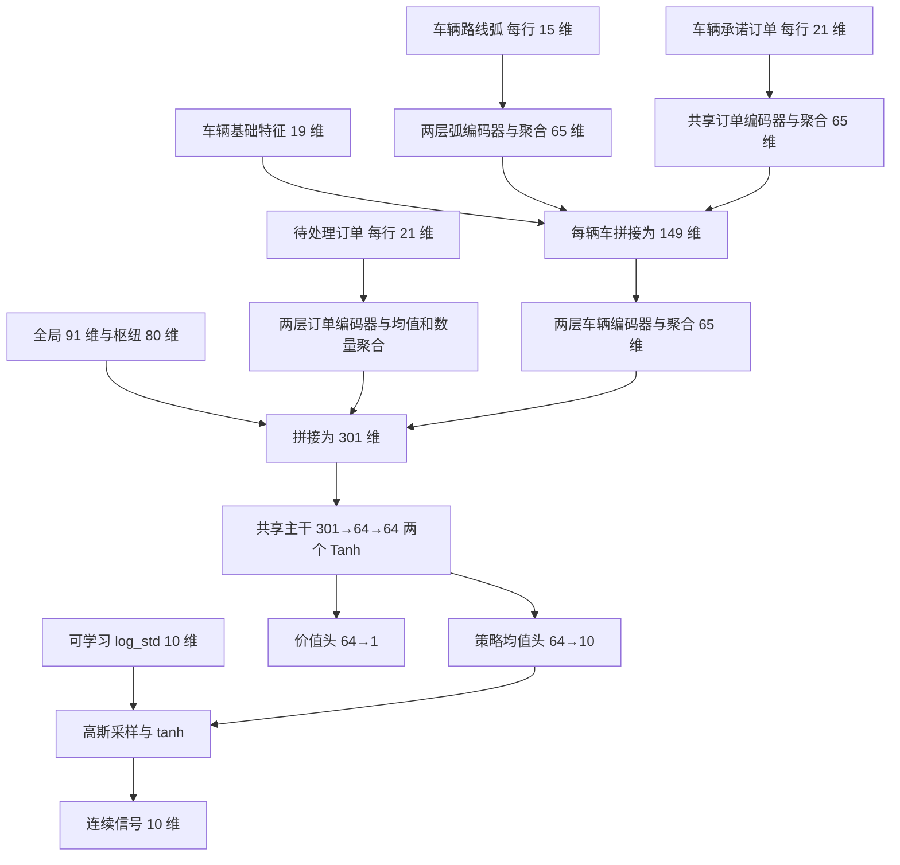

# PPO 强化学习训练架构与现状说明

核对日期：2026-10-10。本文依据当前代码、冻结配置和已完成训练日志，从强化学习训练视角描述实际实现。参数以已完成的笔记本轻量实验 `cfs_laptop_ppo_v1` 为准；后续动态／固定信号实验复用了这些模型，没有追加训练。原大规模实验方案未执行，不能作为实际训练规模。

## 1. 当前模型是什么

当前实现是一个**连续动作、有限时域、完整 episode 采样的 on-policy PPO Actor–Critic**。

策略接收公开运营观测，输出每个枢纽的两个连续价值修正信号；固定的 H=1 整数规划解码器把信号转成实际订单分配和路线，环境执行后返回实现利润增量。PPO 学习的是信号策略，整数规划模型不参与神经网络参数更新。

| 项目 | 实际实现 |
|---|---|
| 算法 | PPO-Clip + GAE |
| 训练方式 | 在线采样、on-policy、完整 episode |
| 策略类型 | 对角高斯，经 `tanh` 压缩的连续随机策略 |
| 价值函数 | 状态价值函数 `V(o)`，输出一个标量 |
| 输入编码 | 分层集合编码 + 共享全连接主干 |
| 输出动作 | 5 个枢纽 × near/far 两个分量 = 10 维 |
| episode | 24 个主动决策时段，最后一步包括已承诺任务的完整冷却结算 |
| 求解器作用 | 环境动作解码，每个决策步调用一次 H=1 MILP |
| 计算方式 | CPU、单进程、串行环境，Torch／BLAS／MILP 各 1 线程 |
| 实际模型数 | 3 个工况 × 3 个训练种子 = 9 个独立训练模型 |

未来尚未公开的订单对策略隐藏。因此，严格来说，网络输入是公开观测 `o_t`，不是包含整个未来订单日程的完整模拟器状态。实现采用无记忆前馈策略，并用历史 OD 计数补充过去信息；目前没有证明这个观测对数据生成过程满足严格 Markov 充分性。

## 2. 状态／观测空间

### 2.1 输入结构与维度

输入包含固定长度的全局／枢纽特征，以及可变长度的订单、车辆、已承诺订单和路线弧集合。设枢纽数为 `H`，当前三个工况均为 `H=5`。

| 输入对象 | 单个对象的维度公式 | H=5 时 | 对象数量 |
|---|---:|---:|---|
| 全局特征 | `16 + 3H²` | 91 | 1 |
| 单枢纽特征 | `H + 11` | 16 | 5 |
| 单订单特征 | `2H + 11` | 21 | 当前公开待处理订单数 |
| 单车辆基础特征 | `2H + 9` | 19 | 3 或 8 |
| 单路线弧特征 | `2H + 5` | 15 | 每辆车已承诺路线的弧数 |
| 车辆已承诺订单 | 与订单特征相同 | 21 | 每辆车当前承诺订单数 |

因此，原始观测不是一个固定的“91 维状态”。91 维只是全局部分；还包含五个枢纽行和多个可变长度集合。经过集合编码，进入共享主干的固定向量长度为 **301**。

### 2.2 特征内容

- **全局**：当前时间、剩余时间、运营时域、车队规模、容量、速度、成本与延误参数、跨枢纽／重定位开关、接单规则、枢纽间距离矩阵、旅行时间矩阵、截至当前的历史 OD 到达计数。
- **枢纽**：枢纽 one-hot、当前空闲车辆比例、较近／较远的承诺释放车辆比例、待处理订单数量及载荷、紧急订单比例、流入需求、MC 底座当前／较远时间的边际价值、底座查询是否被钳制。
- **订单**：起终点 one-hot、载荷、收入、罚金、预订／就绪／截止时间、订单年龄、距离就绪时间、剩余可行时间，以及已分配／已上车标志。
- **车辆**：当前位置、idle／trip／repos 状态、到达与等待时间及存在标志、剩余空驶节点数 `dead`、承诺完成后的释放枢纽与释放时间。
- **路线弧**：起终点 one-hot、弧在路线中的相对位置、距离、旅行时间、已有载荷和剩余容量。

订单和车辆编号不进入神经网络。全部公开集合行均保留，没有按固定数量截断；集合聚合采用均值和数量特征，车辆排列不影响网络编码。

### 2.3 特征缩放

| 数值类型 | 固定除数 |
|---|---:|
| 金额 | 1,000 |
| 距离 | 100 |
| 时间 | 24 |
| 载荷／容量 | 40 |

部分数量按车队规模归一化，类别字段使用 one-hot 或布尔值。没有在线均值方差标准化，也没有把所有输入统一裁剪到 `[−1,1]`。这些固定尺度在训练、验证和测试中一致。

未公开未来订单、场景种子、场景 ID 和模拟器内部目标账本 `J` 不进入观测。历史 OD 计数是截至当前的已公开信息。

## 3. 动作空间与动作含义

### 3.1 连续 10 维动作

按冻结枢纽顺序，动作写为：

```text
a_t = [a_1_near, a_1_far, a_2_near, a_2_far, ..., a_5_near, a_5_far]
```

每个分量经 `tanh` 约束在 `[−1,1]`。它表示对车辆未来释放价值的归一化残差修正。零动作意味着只使用冻结 MC 底座。

在决策时刻 `t`，对在 `τ` 时刻、枢纽 `h` 释放的第 `q` 个供给槽，解码器使用：

```text
ℓ = (τ − t) / (T − t)
ΔV_h(τ | o_t) = S_h × [(1 − ℓ) a_h_near + ℓ a_h_far]，当 τ < T
ΔV_h(τ | o_t) = 0，当 τ ≥ T
最终战略系数 = 冻结 MC 边际价值(τ,h,q) + ΔV_h(τ | o_t)
```

`near/far` 是剩余时域插值的两个端点信号，并非两个互斥时间桶。`S_h` 是事先冻结的美元尺度，取该枢纽非终端底座网格绝对值中位数与 100 USD 的较大者，覆盖 `q=1..车队规模`。

| 工况 | 按冻结枢纽顺序排列的 S_h，USD，显示至两位小数 |
|---|---|
| CA：80 单／3 车 | 2798.77、4612.79、2082.01、3923.53、3938.48 |
| W40：40 单／8 车 | 130.60、212.93、257.54、269.55、226.49 |
| W80：80 单／3 车 | 4832.15、4861.00、5721.48、6116.83、5465.48 |

不同工况下，同样的归一化动作对应的美元修正幅度不同。残差对同一枢纽各供给槽 `q` 相同；底座原有的供给数量曲线不会由 Actor 分别重塑。

### 3.2 动作如何产生环境回报

每个环境步依次执行：公开观测 → Actor 生成信号 → 修正 MILP 的释放价值系数 → 求解整数订单／路线决策 → 环境执行 → 结算实现利润增量 → 下一公开观测。

PPO 不对 MILP 求导；训练使用采样动作的概率比与优势估计。连续信号到整数决策的映射可能在一段信号范围内保持同一方案，因此“小幅改变动作”未必产生不同奖励。

## 4. 策略函数与价值函数的神经网络

### 4.1 编码器结构

所有隐藏层宽度均为 **64**，激活函数均为 **Tanh**。线性层均包含偏置。

| 模块 | 实际层结构 | 输出 |
|---|---|---:|
| 订单编码器 | `Linear(21,64) → Tanh → Linear(64,64) → Tanh` | 均值池化 64 维 + `log(1+数量)`，共 65 维 |
| 路线弧编码器 | `Linear(15,64) → Tanh → Linear(64,64) → Tanh` | 同上，65 维 |
| 车辆编码器 | `Linear(149,64) → Tanh → Linear(64,64) → Tanh` | 车辆集合均值 64 维 + 数量，共 65 维 |
| 共享主干 | `Linear(301,64) → Tanh → Linear(64,64) → Tanh` | 64 维 |
| 策略均值头 | `Linear(64,10)` | 10 维高斯潜变量均值 |
| 价值头 | `Linear(64,1)` | 1 维状态价值 |
| 策略尺度 | 单独的 10 维可学习 `log_std` 参数 | 10 维标准差，与状态无关 |

每辆车输入的 149 维 = 19 维车辆基础特征 + 65 维路线弧编码 + 65 维已承诺订单编码。待处理订单和车辆承诺订单复用同一个订单编码器。

共享主干输入的 301 维 = 91 维全局特征 + `5×16=80` 维枢纽特征 + 65 维待处理订单集合 + 65 维车辆集合。空集合用零向量表示。



这不是一张统一的“两层网络”：全局特征到输出经过 3 个线性层；待处理订单经过 5 个；路线弧或承诺订单经车辆层级到输出，最长路径经过 7 个。各集合编码器是两层，共享主干也是两层，输出头各一层。

完整训练网络共有 **48,725 个可学习参数**。导出的最佳推理网络去掉 65 个价值头参数，保留 **48,660 个参数**，其中包括 `log_std`。当前没有循环层、注意力层、图神经网络、残差连接、Dropout 或归一化层。

### 4.2 策略函数 πθ(a|o)

令共享编码为 `h(o)∈R⁶⁴`：

```text
μθ(o) = W_actor h(o) + b_actor
σθ = exp(clamp(log_std, −5, 2))
z_t ~ Normal(μθ(o_t), diag(σθ²))
a_t = tanh(z_t)
```

策略均值头的权重和偏置初始化为零，因此初始确定性动作是零残差。初始 `log_std=−0.5`，潜变量标准差约为 **0.607**，初始随机训练动作仍有探索变化。

训练时随机采样；验证与测试时使用 `a=tanh(μθ(o))`。这个确定性动作是对潜变量均值作变换，通常不等于压缩后随机动作的数学期望。动作 log probability 包含 `tanh` 的 Jacobian 修正，十个维度的 log probability 求和。

### 4.3 价值函数 Vφ(o)

```text
Vφ(o) = w_criticᵀ h(o) + b_critic
```

这是无输出激活约束的单标量，目标是预测从当前观测开始的未来累计缩放奖励。Actor 和 Critic 共用全部编码器与 64 维主干，只在最后输出头分开，使用同一个优化器。

实际训练目标是 GAE 的 λ-return，而非把最终全天利润直接复制到每个时段。没有 `Q(o,a)` 网络，也没有目标网络。

必须区分两个“价值”：**神经网络 Critic 的状态价值**用于优势估计；**冻结 MC 车辆释放边际价值**进入 MILP 系数。它们不是同一函数，也没有在本次训练中联合更新。

## 5. 奖励、回报和终止

以权威实现账本累计利润 `P_t` 定义：

```text
原始步奖励 r_t_USD = 当前结算累计利润 − 上次结算累计利润
训练步奖励 r_t = r_t_USD / 1000
γ = 1
全天训练回报 = Σ r_t = 最终实现利润 / 1000
```

奖励依据原执行账本计算。战略价值系数和求解器 tie-break 不是现金奖励，也没有额外的残差大小惩罚、模仿损失或奖励塑形项。

24 个主动时段结束后，环境继续完成已承诺运输，完整冷却结算计入第 24 个动作对应的最后奖励。冷却过程不追加 PPO 动作或 rollout 行，终止状态的 bootstrap 价值取零。每个完整训练日恰有 **24 条 transition**。

没有奖励裁剪、回报在线标准化或纯终端奖励设计。收益与成本可以在中间时段发生，也可能延后显现。超时／求解失败作为异常终止训练，不能伪装成一个成功完成的 episode。

## 6. PPO 训练目标与更新流程

### 6.1 GAE 与优势归一化

```text
δ_t = r_t + γ V_old(o_{t+1}) − V_old(o_t)
A_t = δ_t + γλ A_{t+1}，从完整 episode 尾部倒推
价值训练目标 R̂_t = A_t + V_old(o_t)
```

其中 `γ=1`、`λ=0.95`，终止后的 `V_old=0`。每个 episode 独立计算 GAE，再拼接本次采样的四个 episode。对整个 **96 条 transition 的 rollout batch** 做优势标准化：减均值，除以总体标准差，并设置 `1e−8` 的下界。价值目标只做金额固定缩放，不做同样的标准化。

### 6.2 损失函数

```text
ρ_t = exp(log π_new(a_t|o_t) − log π_old(a_t|o_t))
L_policy = −mean(min(ρ_t A_t, clip(ρ_t,0.8,1.2) A_t))
L_value = mean((V_new(o_t) − R̂_t)²)
L_total = L_policy + 0.5 L_value − 0.0 × Entropy
```

策略概率比裁剪为 `[0.8,1.2]`；价值损失使用普通 MSE，没有 value clipping。代码计算压缩策略的采样熵，但熵系数为零，因此当前熵项不影响总损失。可学习标准差仍可以通过策略损失更新。

### 6.3 每次更新如何执行

1. 固定本轮策略，随机抽取并执行 4 个完整训练场景，生成 96 条 on-policy transition。
2. 保存旧 log probability、潜变量、价值预测，计算 GAE 与价值目标。
3. 对本轮数据最多训练 4 个 epoch，每个 epoch 重新打乱。
4. minibatch 上限为 64，因此每个 epoch 有两个 minibatch：64 条和 32 条；最后一批不丢弃。
5. 合并策略／价值损失反向传播，对全部网络参数统一裁剪梯度，再执行 Adam 更新。
6. 若当前 minibatch 的近似 KL 超过 0.03，在该 minibatch 更新前结束本轮余下 epoch。
7. 丢弃本轮训练数据，下一轮用更新后的策略重新采样；在指定更新点进行独立验证并保存检查点。

原始轨迹落盘用于回放和审计，不是跨更新复用的经验回放池。环境串行执行，未采用并行向量环境。

## 7. 超参数与“步长”口径

| 参数 | 已执行数值 | 含义 |
|---|---:|---|
| 学习率 | `3×10⁻⁴` | Adam 学习率，全训练期间固定 |
| Adam betas | `(0.9,0.999)` | 一阶／二阶动量系数 |
| Adam epsilon | `1×10⁻⁸` | 数值稳定项 |
| 权重衰减 | 0 | 无 weight decay |
| 隐藏层宽度 | 64 | 所有编码器和主干 |
| PPO 更新轮数 | 8 | 每个模型采样／优化的外层次数 |
| 每次更新 episode 数 | 4 | 96 条 transition |
| 每个 episode 决策步数 | 24 | 一个步推进一个模拟决策时段 |
| PPO epoch 数 | 最多 4 | 同一 rollout batch 的重复优化次数 |
| minibatch size | 上限 64 | 96 条数据分为 64＋32 |
| PPO clip ε | 0.2 | 策略概率比裁剪 |
| 折扣 γ | 1.0 | 有限时域累计利润不折扣 |
| GAE λ | 0.95 | 时序优势估计参数 |
| value coefficient | 0.5 | 价值 MSE 权重 |
| entropy coefficient | 0.0 | 当前没有熵奖励 |
| reward scale | 1,000 | 原始 USD 奖励除数 |
| max grad norm | 0.5 | 全部参数统一梯度范数裁剪 |
| target KL | 0.03 | 超阈值结束当前 PPO 更新剩余部分 |
| 验证频率 | 每 4 次更新 | 在更新 4、8 时各验证一次 |
| 模型训练种子 | 30001、30002、30003 | 各工况独立训练三个模型 |

学习率不是环境时间步长。这里环境步长是一个模拟时段，运营时域为 24 个时段；场景称作“运营日”，不代表真实日期重放。外层更新 8 次也不等于只执行 8 次梯度更新：无 KL 提前结束时，一个模型执行 `8×4×2=64` 次 Adam 更新。实际九个模型合计 **571 次 Adam 更新**，少于理论上限 576 次。

没有学习率衰减、warmup、自动预算延长或以验证收益平台为标准的训练早停。训练到预设的 8 次更新结束；KL 早停只限制某次更新内的优化，并不结束整个训练。

## 8. 训练数据规模与采样

### 8.1 数据来源与三个工况

场景依据 CFS 2022 数据池抽样生成。预订、就绪、截止时间、载荷单位转换、收入、罚金、车队和网络采用既定生成规则，属于数据驱动的合成运营场景，不能称为真实运营日轨迹。

| 工况 | 枢纽数 | 每场景订单数 | 车辆数 | 训练池 | 验证池 | 首轮测试池 |
|---|---:|---:|---:|---:|---:|---:|
| CA／california_corridor | 5 | 80 | 3 | 32 | 8 | 12 |
| W40／western_multicluster | 5 | 40 | 8 | 32 | 8 | 12 |
| W80／western_multicluster | 5 | 80 | 3 | 32 | 8 | 12 |

每个模型使用对应工况自己的场景池，不把三个工况合成一个共享策略训练集。

### 8.2 名义规模与实际访问规模

| 口径 | 每个模型 | 全部九个模型 |
|---|---:|---:|
| 完整训练 episode 执行数 | 32 | 288 |
| 进入 PPO 的 transition 数 | 768 | 6,912 |
| 外层 PPO 更新次数 | 8 | 72 |
| 训练期间验证 episode 执行数 | 16 | 144 |
| Adam 更新次数 | 61～64 | 571 |

训练场景是**从 32 个场景池中有放回随机抽样 32 次**，不是把 32 个不同场景遍历一遍。实际每个模型访问 19～21 个不同场景，详见后面的逐模型表。三个种子使用同一工况的训练池，不能将多种子训练重复执行视为新增独立场景。

同一天的 24 个时段相互关联，因此 768 条 transition 不等于 768 个独立运营日。验证与测试不参与 PPO 梯度更新。训练池种子为 20000–20031，验证为 21000–21007，首轮测试为 22000–22011；ID、种子及完整场景内容执行了跨分割隔离检查。

最新机制实验另使用每工况 8 个新测试场景（22012–22019），只用于冻结模型评价，没有增加训练数据。

## 9. 验证、检查点与复现

更新 4、8 时，在同一组 8 个验证场景上执行确定性策略，按平均最终实现利润选择最佳检查点，并列保留较早的一次。测试前冻结全部九个模型，测试结果不参与选择训练 seed 或检查点。

每次更新保存恢复包，包括网络、Critic、Adam 状态和各随机数状态；最佳推理包不包含 Critic 或优化器。网络初始化、动作采样、minibatch 打乱和场景抽样使用独立的种子／随机数状态。当前方案有源码、参数、底座、数据分割和原始轨迹的身份核验。

七个模型最终选中更新 4，两个 CA 模型选中更新 8。这是有限验证点上的模型选择，不能把“选中较早检查点”解释成已经达到真正最优。

## 10. 训练与收敛情况

### 10.1 逐模型实际训练结果

以下价值损失是对应更新内各实际执行 minibatch 的 MSE 平均；单位为缩放奖励单位的平方。验证利润单位为 USD。显示数值经过四舍五入，精确值保存在原 JSON 日志中。

| 工况 | seed | 不同训练场景数 | Adam 次数 | 首次／末次价值损失 | 更新4／8验证利润 | 选中更新 |
|---|---:|---:|---:|---:|---:|---:|
| CA | 30001 | 21 | 64 | 1606.77／836.53 | 61652.98／57966.73 | 4 |
| CA | 30002 | 21 | 63 | 1349.83／1150.06 | 61907.18／61967.67 | 8 |
| CA | 30003 | 19 | 64 | 1280.99／1046.69 | 62493.25／62664.89 | 8 |
| W40 | 30001 | 21 | 64 | 559.42／479.75 | 42115.22／42115.22 | 4 |
| W40 | 30002 | 21 | 61 | 677.61／390.77 | 42115.22／42115.22 | 4 |
| W40 | 30003 | 19 | 64 | 585.60／455.56 | 43707.11／42115.22 | 4 |
| W80 | 30001 | 21 | 64 | 544.99／398.36 | 42921.03／42139.15 | 4 |
| W80 | 30002 | 21 | 63 | 791.38／353.83 | 44074.88／42242.49 | 4 |
| W80 | 30003 | 19 | 64 | 573.92／516.04 | 41098.33／40866.15 | 4 |

九个模型的末次价值损失均低于首次，但每次更新的场景和策略分布会变化，因此不能据此证明 Critic 在固定分布上收敛。验证收益没有普遍改善：仅两个模型上升，两个完全相同，其余五个下降。

### 10.2 全部 72 次更新的诊断

| 日志指标 | 更新级记录范围 | 解释 |
|---|---:|---|
| 价值 MSE | 353.83～1817.43 | 价值拟合仍有较大残差 |
| 裁剪前梯度范数 | 101.95～244.11 | 记录的是各更新内实际 minibatch 的均值，裁剪阈值为 0.5 |
| 近似 KL | 0.00093～0.00979 | 记录的是已接受 minibatch 的均值 |
| PPO clip fraction | 0～13.84% | 各更新实际 minibatch 的平均比例 |
| 10 维压缩策略熵估计 | 5.76～6.07 | 连续分布的采样熵；不是动作类别数 |
| rollout 动作饱和比例 | 0～0.1042% | 按动作分量统计 `abs(a)>0.99` |
| 出现 KL 提前结束的更新 | 4／72 | 某个被检查 minibatch 超过 0.03 |

更新级平均 KL 小于阈值与发生 KL 提前结束并不矛盾：触发阈值的 minibatch 不执行更新，也不计入已接受 minibatch 的日志均值。梯度范数同样是裁剪前的 minibatch 平均，不能仅凭该表恢复每个 minibatch 的完整分布。

### 10.3 目前可以怎样评价“收敛”

**数值执行方面**：完成了预设训练，记录的损失、梯度和输出通过有限数检查，动作饱和很少，轨迹结算与回放通过。没有观察到使实验中断的数值发散。

**价值学习方面**：首次到末次 MSE 有下降，但没有固定评估分布上的 Critic 误差曲线或 explained variance，不能证明价值函数收敛。

**策略性能方面**：只有 8 次更新和两个验证点，没有稳定平台证据。首轮 PPO 相对 MC 的三工况平均差为 −0.24%、+0.54%、+1.16%，多重比较调整区间均包含零或触及零，未形成稳定优势证据。

**策略状态适应方面**：最新机制实验中，确定性信号相对验证状态均值的平均绝对偏离仅为 0.000319～0.000964；72 个动态／每枢纽固定信号配对利润全部相同，1,728 个时段去掉同质车辆编号后的服务订单与路线组合全部相同。当前短训练策略表现接近固定残差校准，尚未观察到状态适应带来的额外收益。这里的固定信号仍经过时间插值和 MC 底座解码，不等于所有战略系数都是常数。

所以，目前准确的训练结论是：**训练流程已跑通；Critic 有部分拟合变化；尚未证明策略性能收敛，也尚未证明学到了有效动态控制。** 有限样本配对差全零产生的 `[0,0]` bootstrap 区间，不是总体动态收益为零的证明。

## 11. 从训练视角看，尚待解释的瓶颈

| 已观察的现象 | 对训练的含义 | 当前不能直接断言的原因 |
|---|---|---|
| Actor 对状态的确定性响应很弱 | 学到的动态信息没有明显改变整数决策 | 不能仅凭结果判定网络容量不足或输入无效 |
| 价值 MSE 与裁剪前梯度范数较大 | 共享主干的策略／价值更新平衡值得检查 | 总损失数值大小不等于两部分梯度贡献，尚未分别测量 |
| 每模型仅19～21个不同训练场景 | 独立数据覆盖和优势估计样本有限 | 尚未测试增加少量独立场景后的影响 |
| 随机训练，确定性验证／测试 | 必须检查随机策略改善是否体现在均值策略 | 没有同预算随机测试对照，不能确认是部署规则导致 |
| 连续信号经过整数优化 | 一部分动作变化落在同一个整数决策区域 | 较强工程扰动曾改变决策，不能说接口完全不起作用 |
| 同一枢纽残差对所有 q 相同 | 策略只能调整底座价值水平，动作表达受限 | 还没有扩大动作表达的消融实验 |

优先需要补充的训练诊断包括：Actor／Critic 各自及共享主干的梯度贡献、固定验证状态上的价值误差与 explained variance、均值与标准差的变化、动作变化跨过整数决策门槛的幅度，以及更多验证点的学习曲线。这些属于尚未完成的诊断，本文没有将它们写成已证实的根因。

## 12. 计算预算与实际执行范围

当前轻量实验全部数值流程耗时约 **18.45 分钟**，执行进程记录的峰值工作集约 **0.687 GiB**，报告生成前产物约 **1.654 GiB**。这些数字包括训练、验证、基线选择、测试、诊断和分析，不是纯神经网络训练用量。

整个轻量实验共执行 978 个完整 episode，其中仅 288 个训练 episode 的 6,912 条 transition 用于 PPO 梯度更新。其他 episode 属于验证、基线选择、测试或诊断。后续机制实验复用同一批模型，没有增加这些训练规模。

原大规模方案为每模型 128 次更新 × 8 个 episode、每工况 5 个种子，训练总数原定 15,360 个 episode；当前未执行该方案。原 PPO 配置类的默认更新数为 10，实际轻量运行已显式覆盖为 8，不能用默认值代替实验参数。

## 13. 可核验源码与实验文件

以下路径相对于本文件所在的 `reports/`。

| 内容 | 文件 |
|---|---|
| 特征内容、维度和缩放 | [observation.py](../model_families/single/strategic/observation.py) |
| 动作到 MILP 战略系数映射 | [decoder.py](../model_families/single/strategic/decoder.py) |
| 原始奖励与完整 episode | [reward.py](../model_families/single/strategic/reward.py)、[episode.py](../model_families/single/strategic/episode.py) |
| 奖励缩放适配 | [environment.py](../model_families/single/learning/ppo/environment.py) |
| 策略、Critic 和集合编码 | [networks.py](../model_families/single/learning/ppo/networks.py) |
| GAE、PPO 损失、KL 与梯度裁剪 | [backend.py](../model_families/single/learning/ppo/backend.py) |
| 采样、Adam、验证及检查点 | [trainer.py](../model_families/single/learning/ppo/trainer.py) |
| 配置字段及默认值 | [config.py](../model_families/single/learning/ppo/config.py) |
| 实际轻量配置示例 | 本地 `experiments/cfs_ppo_strategic_control/runs/cfs_laptop_ppo_v1/protocol/california_corridor-n80-k3.json`；实际参数见本文第7节 |
| 轻量实验报告与学习曲线 | [实验报告](cfs_ppo_strategic_control/cfs_laptop_ppo_v1/laptop_experiment_report.md)、[学习曲线](cfs_ppo_strategic_control/cfs_laptop_ppo_v1/figures/01-learning-curves.png) |
| 动态／固定信号机制证据 | [机制实验报告](cfs_ppo_strategic_control/cfs_dynamic_vs_constant_v2/mechanism_experiment_report.md) |

逐模型日志位于 `../experiments/cfs_ppo_strategic_control/runs/cfs_laptop_ppo_v1/training/<工况>/<seed>/`：`update-0001.json` 至 `update-0008.json` 为训练指标，`training-episode-*.json` 为实际采样轨迹，`validation-0004.json`／`validation-0008.json` 为验证结果，`best.json` 为检查点选择记录。本文表格据这些已完成文件汇总，未重新训练或重新评价模型。
