# 第三次数值实验：经典边际价值的 Chebyshev 与 Spline 逼近

所有策略收益均为 **full-cooldown realized profit**。未使用 neural、deep、DRL、SAC 或其他强化学习。
正式模型只使用当前在线信息与构造集统计先验；OraclePreview H8 仅为不可部署的信息放松诊断，不是全日最优上界。

## 1. 完成情况与研究问题

已完成 1920 次正式策略运行（四工况 × 12策略/诊断 × 40场景），失败 0。每条件 40 paired seeds 3000–3039；pilot 240次只作实现检查，不混入正式CI。
构造集配对边际目标 14400 条，验证集 5400 条；解析终端锚点另存，不当作独立MC样本。held-out目标 4320 条来自12个正式场景。
问题是低维价值的正则性、局部结构以及 tail value 能否替代部分显式前视。不能仅凭最低拟合误差宣布方法胜出，不能从Oracle潜力直接推出DRL必要性。

## 2. 冻结基线与数据

完整阅读第一、第二次报告；原 network-rho、CFS adapter、日终核算、Myopic、RH-Supply H4/H8、runner源码均保持原hash。四工况seed1010的Myopic/RH4/RH8共12次历史利润复现误差均小于1e-6，详见manifests/baseline_regression.json。旧报告和旧结果未覆盖。
CFS只读源 SHA256：`c74292117a81082582f26bb1c54618f84e4248b58389280f04a3fb3f8e6236f2`。原WGT_FACTOR加权无放回抽样、双向OD配平、metro坐标/网络、capacity40、成本/运费、时间生成规则和确定性fleet placement保持不变。
CFS是货运记录。货值不是运费；booking/ready/deadline是生成假设；geometry-informed network不是观测高速公路。各seed可能抽中相同原shipment，仿真CI不含调查误差，不能外推全国商业效果。
本次只研究California80/3、Western40/8、Western80/3、Western20/8，**rho固定第二次的rho_max**。没有重跑压力map，也未按正式结果选择半径。第二次1010–1039只作历史基线，不参与价值拟合或新out-of-sample主张。

## 3. 种子、目标和边界

construction：2000–2039（40/工况）；validation：2100–2114（15/工况）；formal policy：3000–3039（40/工况）；held-out value：3000–3011（12/工况）。三个split互不重叠。policy_seed=0，无随机训练seed。经典岭/样条拟合是离线数值回归，不是强化学习。
主动时点采用7个连续Chebyshev根节点映射到0..23，四舍五入并去重，**实际整数节点为 [0, 3, 7, 12, 16, 20, 23]**。这是控制观察时刻、但车辆/订单状态来自自然Myopic轨迹的设计，绝不是连续精确Chebyshev插值网格。
每个节点轮换查询hub；第0、3、6个节点增加相邻hub，支持同状态下空间排序检查。K3计算q=1/2/3；K8计算q=1/2/3/4/6/8；q5、7的表格估值按q插值。两条MC路径先分别保存J(q)、J(q−1)，再平均成拟合观测，不将两路径或不同q当独立统计replication。

`Y(s,t,u,q)=J^{continuation}(s^{-u}+q辆自由车)-J^{continuation}(s^{-u}+(q-1)辆自由车)`。

s^-u只移除查询hub当前自由idle车，保留其他idle车和全部承诺；车辆ID重新连续编号。两世界使用相同网络、成本、需求实现、continuation与seed，并执行到全部承诺结束。主目标continuation=原Myopic V0，不是全日最优值。增加车可能改变贪心决策，因此边际值无需强制非负或递减。
第一条未来路径是该构造/验证/held-out场景的剩余订单；第二条从**同split**固定offset donor取booking>t的剩余未来，并重命名ID避免撞单。已观察当前订单保留。此经验重采样没有严格条件化剩余订单总数，也不是正确现实需求后验。donor复用导致价值误差CI仅为探索性的scenario-block口径；正式策略的40个场景CI与此分开。
当前pool、未揭示订单不能进入在线V。统计expected demand只来自构造集均匀booking率及OD/货重/运费均值；正式未来记录仅在调度器中按booking释放，Oracle专用接口除外。
边界是**新自由资源在T时不能发起任何新控制**，不是原承诺价值为零：两世界commitment相同，冷却收入/费用会抵消，故V(T,u,q)=0成立。T前发起、T后完成的任务仍完整记收入/费用。raw拟合与terminal-anchored候选都保存；anchored只在各hub、q1、其他特征中位数组合精确约束零，不能冒称对所有additive组合都连续趋零。所有provider在time>=T使用准确自由资源零门限。

## 4. 统一接口、线性目标与模型

`ValueProvider.marginal_release_value(time, hub, supply_slot, online_state_summary)` 返回固定数值；solver不认识具体Chebyshev/spline表达式。候选释放事件在求解前评价，只有线性常系数进入目标。
同(time,hub)使用binary z_q，sum z_q=该处sink release流量，并强制z_q≤z_(q−1)。因此两辆只能取q1+q2，不能重复q1，也不能因为q3特别高而跳过q2。测试包含非单调/负系数。每辆车只在窗口最后进sink时领取tail，不能在中间hub反复领取。RH4内已完成再复用的车辆只计最终资源。
M+V用H1窗口的同一单期可行集；V0仍调用原Myopic。RH4+V只改独立value planner，原RH4/RH8不变；窗口[t,min(t+H,T))，k=1；路线macro-action限制沿用第二次，不是所有逐期动作序列的精确展开。

| 方法 | 表示与限制 |
|---|---|
| Zero | 原Myopic / 原RH-Supply，V=0 |
| FluidDual | 构造集需求的fractional时空LP shadow-price surface；在q−1供给处取dual，离线初始其他hub供给冻结；不响应当前backlog；放松整车/锚点，允许空调位。它是简单、乐观surrogate，对相同MC离散realized目标测误差，而不是宣称LP dual恰好等于该目标 |
| MC Table | time/hub/q配对MC均值；时间与缺失整数q线性插值；忽略在线backlog等 |
| Linear Ridge | hub截距与标准化remaining、other idle、incoming、backlog、expected demand、q |
| Chebyshev | 同六特征的additive Chebyshev LS/ridge；remaining映射[-1,1]；p=2..6；无full tensor |
| Cubic Spline/GAM | 六特征additive cubic B-spline；二阶系数差分惩罚；ordinary/natural；4/6/8/10 requested internal knots，quantile去重后actual数量逐特征记录 |

所有回归候选使用同一paired realized marginal标签。Natural spline用端点二阶导数零约束的null-space；不是exact cubic interpolation。Spline块中心化，微小isotropic ridge稳定非识别offset；部分设计仍rank-deficient、正则化条件数很高，必须谨慎解释原始系数。
online摘要包含查询hub之外idle、已知最终idle release incoming、当前hub-origin backlog load、构造先验remaining demand、q。RH-terminal在当前摘要上评价未来释放时刻，**没有联合更新候选动作之后的backlog/其他hub supply**；属于冻结摘要tail近似。未来估计状态与自然构造状态存在distribution shift，不能将策略退化直接归因于函数类失败。不得把它称为完整post-decision value或准确future-demand预测。

## 5. 验证选择与数值稳定性

模型只按validation RMSE最小选择，MAE、ranking、索引用于tie-break；所有raw/anchored和ordinary/natural候选在models/candidates/。选定后models/selection.json及model_freeze.json保存hash，代码先冻结再生成formal利润。pilot使用验证集前5seed，只检查运行和预算；没有删除低收益方法，完整ladder保留到formal。

| 工况 | Cheb p / lambda / boundary | Spline requested knots / lambda / boundary | val RMSE Cheb / Spline | 正则矩阵cond Cheb / Spline |
|---|---|---|---:|---:|
| California N=80, K=3 | 6 / 0.01 / anchored | 10 / 0.1 / ordinary, anchored | 5,082.02 / 5,087.88 | 3.47e+06 / 1.35e+09 |
| Western N=40, K=8 | 5 / 100 / raw | 6 / 1000 / ordinary, raw | 1,330.16 / 1,324.57 | 557 / 1.46e+10 |
| Western N=80, K=3 | 6 / 1 / raw | 8 / 0.1 / ordinary, raw | 3,956.72 / 3,950.04 | 8.85e+04 / 2.1e+09 |
| Western N=20, K=8 | 3 / 1 / raw | 6 / 10 / natural, raw | 540.25 / 540.69 | 2.12e+04 / 4.2e+09 |

高q多项式可只有3或6个distinct样本值；time、expected等也相关。rank、EDF、regularized conditioning、roughness和actual knots在候选/最终模型中。不能仅从某一组不唯一additive系数下降推断真实V spectral smooth；图3是所选正则化表示的系数，不是唯一经济分解。未在测试集上增设interaction或调惩罚。Fluid使用q−1处的infinitesimal LP dual，可能显著高于整辆车的finite difference；需先对统一paired target校准，不能把本次简化Fluid失败概括为所有流体价值方法失败。

### Runge专项

独立控制切片固定Western40/8、hub 04-429、q1、初始其他hub供给及零当前backlog，只有观察时点变化；10个构造seed，paired未来，完整cooldown。MC参考均值仍有噪声与跨时点相关，不是真实无噪population函数。
在同一13个离散等距节点的MC参考上，对比degree12 monomial与同degree12 Chebyshev插值（隔离basis影响），再对比低阶Cheb ridge及penalized cubic spline（正则化模型对照）；未用于正式policy。前两者表示同一多项式，均可能产生端点振荡，不能将低阶ridge的改善全部归因于换basis。外推[-1.15,1.15]只用于诊断，正式provider对特征clip、T准确gate。max error、RMSE、endpoint RMSE、condition number与±1.1外推保存于runge_numerical_diagnostics.csv。
另用解析Runge函数1/(1+25z²)隔离节点设计：**同等距节点、同degree的monomial和Chebyshev exact interpolation给出同一个数学多项式**，换basis只能改善conditioning，不能消除节点引发的振荡。Chebyshev nodes改善节点设计；正式方法采用低阶LS/ridge而非高阶等距exact interpolation。

| MC切片方法 | RMSE | max abs error | endpoint RMSE | design cond |
|---|---:|---:|---:|---:|
| monomial | 6,966.92 | 25,073.00 | 17,084.12 | 1.23e+05 |
| cheb_same_degree | 6,966.92 | 25,073.00 | 17,084.12 | 71.3 |
| chebyshev | 506.23 | 1,298.24 | 411.03 | 1.81 |
| spline | 934.83 | 2,427.14 | 776.94 | 4.72 |

## 6. 独立held-out价值预测

以下每条件12个scenario，MC两路径先在同state/q平均，解析T锚点不计评分。time/hub/q calibration、sign、endpoint/max error、每seed误差CI分别保存；不是把所有状态当独立replication。sign_accuracy按浮点exact sign计算，接近零的MC噪声可影响该分数。空间同q排序更直接评价“释放到A还是B”，总pairwise还包括同hub不同q，不能互相混称。

| 工况 | 方法 | MAE | RMSE | R² | Spearman | pair rank | 同q空间 rank | sign |
|---|---|---:|---:|---:|---:|---:|---:|---:|
| California N=80, K=3 | fluid | 26,374.57 | 47,932.45 | -70.662 | 0.411 | 0.639 | 0.529 | 0.328 |
| California N=80, K=3 | table | 3,072.43 | 4,565.96 | 0.350 | 0.617 | 0.755 | 0.667 | 0.778 |
| California N=80, K=3 | linear | 3,220.16 | 4,495.14 | 0.370 | 0.605 | 0.738 | 0.618 | 0.750 |
| California N=80, K=3 | chebyshev | 3,086.54 | 4,256.77 | 0.435 | 0.629 | 0.731 | 0.627 | 0.747 |
| California N=80, K=3 | spline | 3,027.49 | 4,230.87 | 0.442 | 0.645 | 0.729 | 0.627 | 0.772 |
| Western N=40, K=8 | fluid | 11,680.65 | 30,808.12 | -278.483 | 0.315 | 0.572 | 0.467 | 0.419 |
| Western N=40, K=8 | table | 924.28 | 1,530.15 | 0.311 | 0.426 | 0.672 | 0.530 | 0.618 |
| Western N=40, K=8 | linear | 1,066.43 | 1,663.44 | 0.185 | 0.419 | 0.681 | 0.480 | 0.489 |
| Western N=40, K=8 | chebyshev | 999.90 | 1,587.03 | 0.258 | 0.453 | 0.685 | 0.507 | 0.493 |
| Western N=40, K=8 | spline | 999.38 | 1,586.90 | 0.258 | 0.459 | 0.686 | 0.513 | 0.494 |
| Western N=80, K=3 | fluid | 27,710.68 | 48,339.33 | -83.437 | 0.339 | 0.605 | 0.490 | 0.300 |
| Western N=80, K=3 | table | 3,044.29 | 4,325.82 | 0.324 | 0.661 | 0.749 | 0.600 | 0.917 |
| Western N=80, K=3 | linear | 3,228.52 | 4,462.92 | 0.280 | 0.604 | 0.739 | 0.552 | 0.881 |
| Western N=80, K=3 | chebyshev | 3,025.81 | 4,240.39 | 0.350 | 0.641 | 0.739 | 0.562 | 0.917 |
| Western N=80, K=3 | spline | 3,009.84 | 4,217.60 | 0.357 | 0.653 | 0.736 | 0.562 | 0.917 |
| Western N=20, K=8 | fluid | 13,845.20 | 39,058.04 | -2036.115 | 0.435 | 0.627 | 0.500 | 0.667 |
| Western N=20, K=8 | table | 326.34 | 689.14 | 0.366 | 0.497 | 0.767 | 0.561 | 0.588 |
| Western N=20, K=8 | linear | 454.21 | 770.17 | 0.208 | 0.445 | 0.773 | 0.500 | 0.350 |
| Western N=20, K=8 | chebyshev | 417.44 | 744.06 | 0.261 | 0.484 | 0.760 | 0.510 | 0.342 |
| Western N=20, K=8 | spline | 413.52 | 732.35 | 0.284 | 0.482 | 0.756 | 0.490 | 0.340 |

## 7. 正式策略利润与配对CI

每个条件40个场景；参数、算法、q、MC路径都不是独立统计样本。下表为mean、sample SD、median、Student-t95% CI；|skew|>1补10000次固定seed paired bootstrap，完整值在CSV。主要比较预先设定；另列Cheb−Spline探索性比较，不用于冻结模型选择。均为marginal区间，未多重比较校正。

| 工况 | 策略 | n | mean profit | SD | median | t95% CI |
|---|---|---:|---:|---:|---:|---|
| California N=80, K=3 | P0-Myopic | 40 | 57,522.22 | 11,313.35 | 57,842.82 | [53,904.03, 61,140.40] |
| California N=80, K=3 | P1-Myopic-Fluid | 40 | 35,340.46 | 9,095.20 | 35,168.52 | [32,431.67, 38,249.24] |
| California N=80, K=3 | P2-Myopic-Table | 40 | 53,468.41 | 10,899.39 | 52,251.01 | [49,982.62, 56,954.21] |
| California N=80, K=3 | P3-Myopic-Linear | 40 | 59,081.00 | 8,054.87 | 61,835.66 | [56,504.93, 61,657.07] |
| California N=80, K=3 | P4-Myopic-Chebyshev | 40 | 57,221.89 | 8,918.14 | 57,805.16 | [54,369.74, 60,074.05] |
| California N=80, K=3 | P5-Myopic-Spline | 40 | 56,554.60 | 9,742.61 | 56,915.47 | [53,438.77, 59,670.44] |
| California N=80, K=3 | P6-RH4 | 40 | 59,650.56 | 10,415.93 | 59,671.96 | [56,319.38, 62,981.73] |
| California N=80, K=3 | P7-RH4-Fluid | 40 | 42,353.05 | 7,484.15 | 42,128.96 | [39,959.50, 44,746.60] |
| California N=80, K=3 | P8-RH4-Chebyshev | 40 | 57,135.21 | 11,536.84 | 58,269.50 | [53,445.55, 60,824.87] |
| California N=80, K=3 | P9-RH4-Spline | 40 | 59,984.80 | 10,119.91 | 59,944.61 | [56,748.30, 63,221.31] |
| California N=80, K=3 | P10-RH8 | 40 | 62,317.92 | 10,294.92 | 61,745.46 | [59,025.44, 65,610.39] |
| California N=80, K=3 | D-OracleH8 | 40 | 65,440.38 | 7,721.33 | 64,279.13 | [62,970.98, 67,909.79] |
| Western N=40, K=8 | P0-Myopic | 40 | 38,494.78 | 5,532.31 | 39,373.15 | [36,725.46, 40,264.10] |
| Western N=40, K=8 | P1-Myopic-Fluid | 40 | 33,851.94 | 5,729.35 | 32,703.49 | [32,019.61, 35,684.28] |
| Western N=40, K=8 | P2-Myopic-Table | 40 | 42,226.74 | 4,468.20 | 41,652.09 | [40,797.74, 43,655.74] |
| Western N=40, K=8 | P3-Myopic-Linear | 40 | 38,113.26 | 4,642.23 | 37,938.34 | [36,628.61, 39,597.92] |
| Western N=40, K=8 | P4-Myopic-Chebyshev | 40 | 40,629.65 | 4,962.80 | 40,644.63 | [39,042.47, 42,216.83] |
| Western N=40, K=8 | P5-Myopic-Spline | 40 | 39,848.03 | 4,988.24 | 39,880.20 | [38,252.72, 41,443.35] |
| Western N=40, K=8 | P6-RH4 | 40 | 39,401.08 | 5,873.21 | 40,595.18 | [37,522.74, 41,279.43] |
| Western N=40, K=8 | P7-RH4-Fluid | 40 | 34,522.21 | 5,485.60 | 34,680.94 | [32,767.83, 36,276.59] |
| Western N=40, K=8 | P8-RH4-Chebyshev | 40 | 42,283.04 | 5,000.87 | 41,429.76 | [40,683.68, 43,882.39] |
| Western N=40, K=8 | P9-RH4-Spline | 40 | 40,578.67 | 4,290.86 | 40,889.78 | [39,206.39, 41,950.95] |
| Western N=40, K=8 | P10-RH8 | 40 | 39,710.19 | 5,589.63 | 40,358.34 | [37,922.54, 41,497.84] |
| Western N=40, K=8 | D-OracleH8 | 40 | 52,372.92 | 3,363.87 | 53,105.38 | [51,297.10, 53,448.73] |
| Western N=80, K=3 | P0-Myopic | 40 | 33,781.69 | 9,856.63 | 35,212.06 | [30,629.38, 36,933.99] |
| Western N=80, K=3 | P1-Myopic-Fluid | 40 | 19,203.45 | 8,248.94 | 17,162.85 | [16,565.31, 21,841.59] |
| Western N=80, K=3 | P2-Myopic-Table | 40 | 41,942.91 | 7,953.60 | 42,217.66 | [39,399.22, 44,486.59] |
| Western N=80, K=3 | P3-Myopic-Linear | 40 | 39,809.85 | 6,319.08 | 39,679.53 | [37,788.91, 41,830.79] |
| Western N=80, K=3 | P4-Myopic-Chebyshev | 40 | 40,825.61 | 7,663.06 | 40,356.12 | [38,374.84, 43,276.37] |
| Western N=80, K=3 | P5-Myopic-Spline | 40 | 40,602.87 | 6,926.55 | 41,011.15 | [38,387.65, 42,818.09] |
| Western N=80, K=3 | P6-RH4 | 40 | 34,359.41 | 9,614.39 | 34,784.51 | [31,284.58, 37,434.24] |
| Western N=80, K=3 | P7-RH4-Fluid | 40 | 21,512.30 | 7,717.90 | 20,859.52 | [19,044.00, 23,980.61] |
| Western N=80, K=3 | P8-RH4-Chebyshev | 40 | 40,929.18 | 9,028.21 | 41,926.46 | [38,041.82, 43,816.54] |
| Western N=80, K=3 | P9-RH4-Spline | 40 | 40,249.56 | 8,513.38 | 40,746.40 | [37,526.85, 42,972.27] |
| Western N=80, K=3 | P10-RH8 | 40 | 34,626.16 | 8,920.53 | 35,424.57 | [31,773.23, 37,479.08] |
| Western N=80, K=3 | D-OracleH8 | 40 | 45,007.44 | 7,834.48 | 45,874.43 | [42,501.85, 47,513.02] |
| Western N=20, K=8 | P0-Myopic | 40 | 18,240.91 | 2,704.75 | 18,437.33 | [17,375.89, 19,105.93] |
| Western N=20, K=8 | P1-Myopic-Fluid | 40 | 15,475.26 | 2,934.55 | 15,332.64 | [14,536.74, 16,413.77] |
| Western N=20, K=8 | P2-Myopic-Table | 40 | 19,436.31 | 2,703.49 | 19,174.81 | [18,571.69, 20,300.93] |
| Western N=20, K=8 | P3-Myopic-Linear | 40 | 18,169.52 | 2,890.52 | 18,527.91 | [17,245.09, 19,093.96] |
| Western N=20, K=8 | P4-Myopic-Chebyshev | 40 | 18,666.03 | 2,512.87 | 18,557.71 | [17,862.38, 19,469.68] |
| Western N=20, K=8 | P5-Myopic-Spline | 40 | 18,774.30 | 2,483.23 | 18,784.96 | [17,980.12, 19,568.47] |
| Western N=20, K=8 | P6-RH4 | 40 | 19,300.16 | 2,897.98 | 19,136.44 | [18,373.35, 20,226.98] |
| Western N=20, K=8 | P7-RH4-Fluid | 40 | 16,241.16 | 2,442.40 | 16,536.52 | [15,460.05, 17,022.28] |
| Western N=20, K=8 | P8-RH4-Chebyshev | 40 | 19,680.96 | 2,506.94 | 19,308.63 | [18,879.20, 20,482.72] |
| Western N=20, K=8 | P9-RH4-Spline | 40 | 19,685.47 | 2,579.94 | 19,217.93 | [18,860.36, 20,510.57] |
| Western N=20, K=8 | P10-RH8 | 40 | 19,727.77 | 2,702.78 | 19,716.93 | [18,863.38, 20,592.16] |
| Western N=20, K=8 | D-OracleH8 | 40 | 24,539.50 | 1,508.30 | 24,534.65 | [24,057.12, 25,021.88] |

### 同场景增益：Myopic+V

| 工况 | Fluid−M0 | Table−M0 | Linear−M0 | Cheb−M0 | Spline−M0 |
|---|---|---|---|---|
| California N=80, K=3 | -22,181.76 [-27,047.80, -17,315.71] | -4,053.80 [-8,881.74, +774.13] | +1,558.78 [-2,951.92, +6,069.48] | -300.32 [-4,802.71, +4,202.07] | -967.61 [-5,553.93, +3,618.70] |
| Western N=40, K=8 | -4,642.84 [-6,828.44, -2,457.24] | +3,731.96 [+1,960.64, +5,503.29] | -381.51 [-1,827.65, +1,064.62] | +2,134.87 [+297.36, +3,972.38] | +1,353.26 [-372.59, +3,079.10] |
| Western N=80, K=3 | -14,578.23 [-18,070.06, -11,086.40] | +8,161.22 [+4,416.47, +11,905.97] | +6,028.16 [+2,597.05, +9,459.28] | +7,043.92 [+3,555.04, +10,532.80] | +6,821.19 [+3,528.82, +10,113.55] |
| Western N=20, K=8 | -2,765.65 [-3,852.77, -1,678.54] | +1,195.40 [+598.74, +1,792.06] | -71.39 [-363.74, +220.97] | +425.12 [+36.45, +813.79] | +533.39 [+125.46, +941.32] |

### Chebyshev−Spline探索性配对比较

事后补充的解释性对照，正值表示Cheb利润较高。不能把两个方法分别对Myopic的显著性不同，当作彼此显著不同。没有预定等价界限，CI跨0也不能证明等效。

| 工况 | Myopic+Cheb−Myopic+Spline [t95 CI] | RH4+Cheb−RH4+Spline [t95 CI] |
|---|---|---|
| California N=80, K=3 | +667.29 [-3,119.22, +4,453.80] | -2,849.59 [-6,941.68, +1,242.50] |
| Western N=40, K=8 | +781.61 [-155.70, +1,718.93] | +1,704.37 [+154.72, +3,254.01] |
| Western N=80, K=3 | +222.74 [-1,117.37, +1,562.84] | +679.62 [-1,360.28, +2,719.51] |
| Western N=20, K=8 | -108.27 [-290.97, +74.44] | -4.51 [-124.20, +115.18] |

## 8. RH4 terminal value 与 horizon compression

| 工况 | RH8−RH4 [CI] | RH4+Fluid−RH4 [CI] | RH4+Cheb−RH4 [CI] | RH4+Spline−RH4 [CI] |
|---|---|---|---|
| California N=80, K=3 | +2,667.36 [+269.58, +5,065.13] | -17,297.51 [-21,335.52, -13,259.50] | -2,515.35 [-6,672.32, +1,641.62] | +334.24 [-3,560.03, +4,228.51] |
| Western N=40, K=8 | +309.11 [-586.61, +1,204.83] | -4,878.87 [-7,074.21, -2,683.54] | +2,881.96 [+1,036.74, +4,727.17] | +1,177.59 [-291.05, +2,646.22] |
| Western N=80, K=3 | +266.75 [-925.80, +1,459.30] | -12,847.11 [-16,820.58, -8,873.64] | +6,569.77 [+3,109.57, +10,029.96] | +5,890.15 [+2,710.87, +9,069.42] |
| Western N=20, K=8 | +427.60 [+33.93, +821.27] | -3,059.00 [-4,197.83, -1,920.17] | +380.79 [+21.81, +739.77] | +385.30 [+37.60, +733.00] |

compression=(RH4+V−RH4)/(RH8−RH4)，只在**分母的t95CI下界>0**时报告。>100%只是本配置均值收益比，不表示更多未来信息。RH4+V−RH8差值与CI在paired_policy_differences.csv；CI跨0只是不确定，不能宣布等价/达到论文要求的noninferiority，后者需预定equivalence margin。

| 工况 | 方法 | horizon compression | Oracle-gap capture |
|---|---|---:|---:|
| California N=80, K=3 | P7-RH4-Fluid | -648.5% | -191.6% |
| California N=80, K=3 | P8-RH4-Chebyshev | -94.3% | -4.9% |
| California N=80, K=3 | P9-RH4-Spline | 12.5% | 31.1% |
| Western N=40, K=8 | P7-RH4-Fluid | 不报告（分母未明确为正） | -28.6% |
| Western N=40, K=8 | P8-RH4-Chebyshev | 不报告（分母未明确为正） | 27.3% |
| Western N=40, K=8 | P9-RH4-Spline | 不报告（分母未明确为正） | 15.0% |
| Western N=80, K=3 | P7-RH4-Fluid | 不报告（分母未明确为正） | -109.3% |
| Western N=80, K=3 | P8-RH4-Chebyshev | 不报告（分母未明确为正） | 63.7% |
| Western N=80, K=3 | P9-RH4-Spline | 不报告（分母未明确为正） | 57.6% |
| Western N=20, K=8 | P7-RH4-Fluid | -715.4% | -31.7% |
| Western N=20, K=8 | P8-RH4-Chebyshev | 89.1% | 22.9% |
| Western N=20, K=8 | P9-RH4-Spline | 90.1% | 22.9% |

## 9. Oracle gap 与 continuation敏感性

Oracle-gap capture=(策略−M0)/(OracleH8−M0)，同样只在分母CI明确为正时报告；是performance gap ratio，不是信息恢复率、预测准确率或可部署收益率。剩余gap可能来自不可预测需求、受限动作族、不同目标/预算、target/integration偏差，不能全部归于模型维数。
- California N=80, K=3：Oracle−M0 +7,918.17 [+4,282.36, +11,553.98]；Oracle减RH4+Cheb均值 8,305.17；Oracle减RH4+Spline 5,455.58。
- Western N=40, K=8：Oracle−M0 +13,878.14 [+12,087.36, +15,668.92]；Oracle减RH4+Cheb均值 10,089.88；Oracle减RH4+Spline 11,794.25。
- Western N=80, K=3：Oracle−M0 +11,225.75 [+6,888.78, +15,562.72]；Oracle减RH4+Cheb均值 4,078.26；Oracle减RH4+Spline 4,757.88。
- Western N=20, K=8：Oracle−M0 +6,298.59 [+5,420.07, +7,177.11]；Oracle减RH4+Cheb均值 4,858.54；Oracle减RH4+Spline 4,854.04。

Western40/8额外以5个construction seeds、t=0/12/23构造MC-RH4 target，并用完全相同查询、状态hash与未来hash复跑MC-Myopic：120个平均目标配对。每seed对固定query组合的mean marginal变化为 +35.86 [-268.16, +339.88]。这是target-policy sensitivity小样本诊断，不能称正式RH4训练或policy改善CI；详见continuation_policy_targets.csv。

## 10. 时间、失败与审计

离线Fluid surface wall 6.23s；MC construction wall 94.22s（worker累计 276.72s）；validation wall 35.92s；全部候选fit wall 4.76s。
正式矩阵wall 1474.43s，3并行worker、每Gurobi一线程。失败0；非OPTIMAL窗口计数 0，最大记录window gap 4.64606e-16。窗口30s限制、每日600s wall限制，无incumbent会保留失败而非静默换算法/删样本。
offline样本生成、offline fit、online value preparation、MILP solver、daily wall分开记录。online_value_eval_seconds实际包含provider评价与slot变量/约束建立，不是单纯浮点函数算术微基准；build_seconds也包含该段，**不能将build与value preparation再相加为互斥时间**。daily_solver_seconds只为Gurobi Runtime合计，daily_wall包含摘要/构建/仿真/ledger/trace计算，输出文件写入不在sim daily计时。CFS冻结输入时间与resume读取时间不混称solver。
逐t独立物理重放审计 1920次run、78058时点：PASSED。核对source/scenario/trace hash、同场景配对、预订边界、无提前/重复分配、capacity、clock、state hash、原始after状态、冷却无控制、realized利润与全部commitment完成。独立编译金额误差≤1e-6后仅保留原记录monetary scalars处理浮点加法顺序，不覆盖物理状态。
固定PYTHONHASHSEED=0的全量测试 128项，failure 0、error 0、skip 0；存在一条既有Starlette/AnyIO依赖弃用警告，不影响通过。独立重跑Western40/8 seed3000 RH4+Spline，利润差 0，物理轨迹完全一致。pytest-full.xml、independent_reproduction.json与qa_validation.json留存证据。
最后复测曾把pytest临时目录误放在非忽略的仓库根层，平台代码身份扫描碰到Windows已锁定的coordinator.lock，出现6项PermissionError；失败记录保留在pytest-placement-check-failed.xml。将本次测试临时文件移至被忽略的workspace并按README重跑后通过，未修改平台扫描器、冻结数值源码或模型；这不属于1920次正式仿真的失败。
运行环境为Windows、Python3.11.14、Gurobi10.0.3；处理器、逻辑核数、NumPy/SciPy/Matplotlib等版本写入最终manifest。并行worker中的wall time含资源竞争，不是标准化硬件上的单进程微基准。MC目标文件未逐个保存扰动求解的status/gap，尤其RH4 continuation仅作小样本敏感性诊断；不能把正式策略全OPTIMAL结论扩展成全部MC子问题的逐项最优证明。
逐t trace保留当前订单/车辆、assignment/route/reposition、常数释放系数、solver/status/gap、各账本与实际利润序列。processed/execution_events/另由无求解重放生成逐车segments、load、pickup与delivery，供检查实际时间序列和Python多实验绘图。raw未覆盖。
字段语义特别说明：raw plan.augmented_solver_objective沿用执行编译器的当前阶段booked profit−delay tie-break，value控制时**不包含tail项**；真正包含V的优化目标在plan.solver.window_objective。H4/H8的window目标还含未执行未来阶段，不能当作当前利润或把每天window目标相加称经营收益。各t实际收益应读取realized_ledger.realized_profit及period_realized_profit，详见trace_field_semantics.json。

## 11. 正则性与Go / No-Go判断

验证RMSE非常接近，不能仅据几美元差距声称Spline具有统计优势或Chebyshev已证明spectral smooth。必须联合held-out误差、空间ranking、系数识别性、端点、配对profit、真实post-decision integration判断。以下为逐工况证据：
- California N=80, K=3：held-out RMSE Cheb 4,256.77 / Spline 4,230.87，数值较低为Spline；同q空间rank 0.627 / 0.627。相对Myopic，RH4+Cheb -387.00 [-5,149.66, +4,375.65]，RH4+Spline +2,462.59 [-1,784.62, +6,709.79]。
- Western N=40, K=8：held-out RMSE Cheb 1,587.03 / Spline 1,586.90，数值较低为Spline；同q空间rank 0.507 / 0.513。相对Myopic，RH4+Cheb +3,788.26 [+1,991.35, +5,585.17]，RH4+Spline +2,083.89 [+524.15, +3,643.63]。
- Western N=80, K=3：held-out RMSE Cheb 4,240.39 / Spline 4,217.60，数值较低为Spline；同q空间rank 0.562 / 0.562。相对Myopic，RH4+Cheb +7,147.49 [+3,610.15, +10,684.83]，RH4+Spline +6,467.87 [+3,137.18, +9,798.57]。
- Western N=20, K=8：held-out RMSE Cheb 744.06 / Spline 732.35，数值较低为Spline；同q空间rank 0.510 / 0.490。相对Myopic，RH4+Cheb +1,440.05 [+890.91, +1,989.18]，RH4+Spline +1,444.56 [+877.67, +2,011.44]。

四工况、两个RH4 classical tail的8个预定增益比较中，5个相对RH4的CI下界>0（未多重校正）。这说明某些低维tail确有用，不能保证全工况。Fluid的分数、无锚点与冻结初始供给会高估未来资源价值；若政策退化，应先修正surrogate和integration，而不是将数值回归的“高级程度”作为解释。
当前不宜单独宣布Case A（低阶全局spectral smooth）或Case B（明确piecewise-smooth胜出）：多数p不是很低，局部q/near-zero行为、终端gate、自然state变化与矩阵非识别混在一起；表格和Spline/Cheb的收益差也不能仅用MSE解释。受控切片与slot图可以显示局部弯曲/非单调，但有限MC噪声下不证明真实值可微阶数。
**下一阶段选择Chebyshev作为主基线，Spline作为局部形状对照；优先修正post-decision摘要与continuation target，再验证少量有经济含义的交互。** 这是稳定性、解释性与增益的综合工程选择，不是证明Cheb利润普遍显著优于Spline。应先区分candidate后backlog/供给变化、route anchor与实际费用，再考虑更丰富空间状态。residual_interactions.csv仅诊断supply×demand与incoming×demand，未用formal target调模型；不直接上full tensor或神经网络。

## 12. 图表与可复现文件

11张图均为7.2英寸双栏、DejaVu Serif、色盲友好颜色+不同markers、600dpi PNG与PDF/SVG矢量。图1的MC误差带按相同时点/hub/q的scenario均值，不把两条路径混作样本；图9ratio是描述性点值，表中利润CI是独立的配对推断。绘图配置及输入CSV hash一并保留。
图1、图4受控MC切片和图11采用symlog纵轴：绝对值1000 USD内线性，外侧对数；图4解析Runge控制的阈值为1。全部极端值保留，避免Fluid/单项式放大值压平其他曲线，不可按图上的等距直接解释绝对利润差。图10用P0–P10及D代码防止文本堆叠，底部给出算法映射；D明确为不可部署Oracle诊断。

核心文件：targets/*.csv/json（路径目标/终端锚点与独立切片）；models/最终与candidates/全部候选；manifests/model_freeze.json；raw/datasets/冻结CFS与source字段；raw/runs/逐t双账；processed/value_predictions.csv与calibration/CI；policy_summary.csv与paired_policy_differences.csv；performance_ratios.csv；plotting_config.json；trace_audit.json。

数值源码逐文件hash、原始基线报告hash、CFS hash、source.snapshot.zip、ValueProvider版本、seed、solver、actual nodes、模型超参数与时间在manifest/模型中；analysis-source.snapshot.zip独立保存后处理来源，避免把报告修订假称新数值运行。源码/config/model变动会阻止续跑，不允许覆盖旧结果。运行命令见experiments/cfs_classical_value/README.md。

局限汇总：经验需求并非真实条件后验；只两个MC paths，target有噪声且donor复用；少数q离散支持及强共线性；低维摘要缺失完整空间/订单结构；候选后摘要未联合更新；Fluid为乐观简化surface；baseline是受限macro-action窗口；只wide rho、四个事先选定工况；没有equivalence margin、多重比较控制或全国外推。新ValueProvider目前用于本次独立实验runner，**尚未新增平台UI framework/schema入口**，不是前端已经可选的新训练流程。

### 论文图集

#### 01_mc_value_time_hub

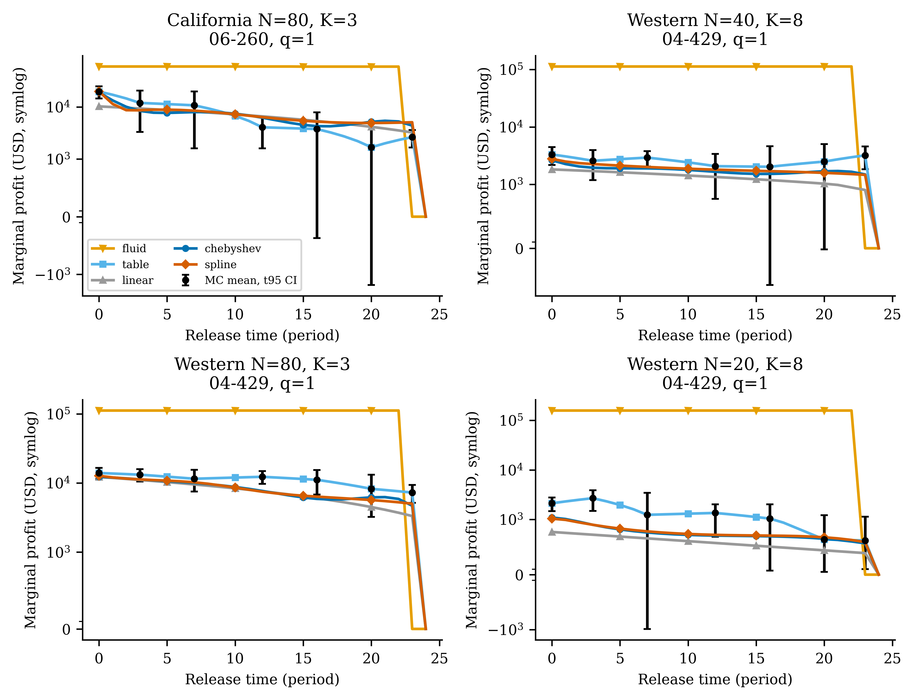

#### 02_fluid_dual_heatmap

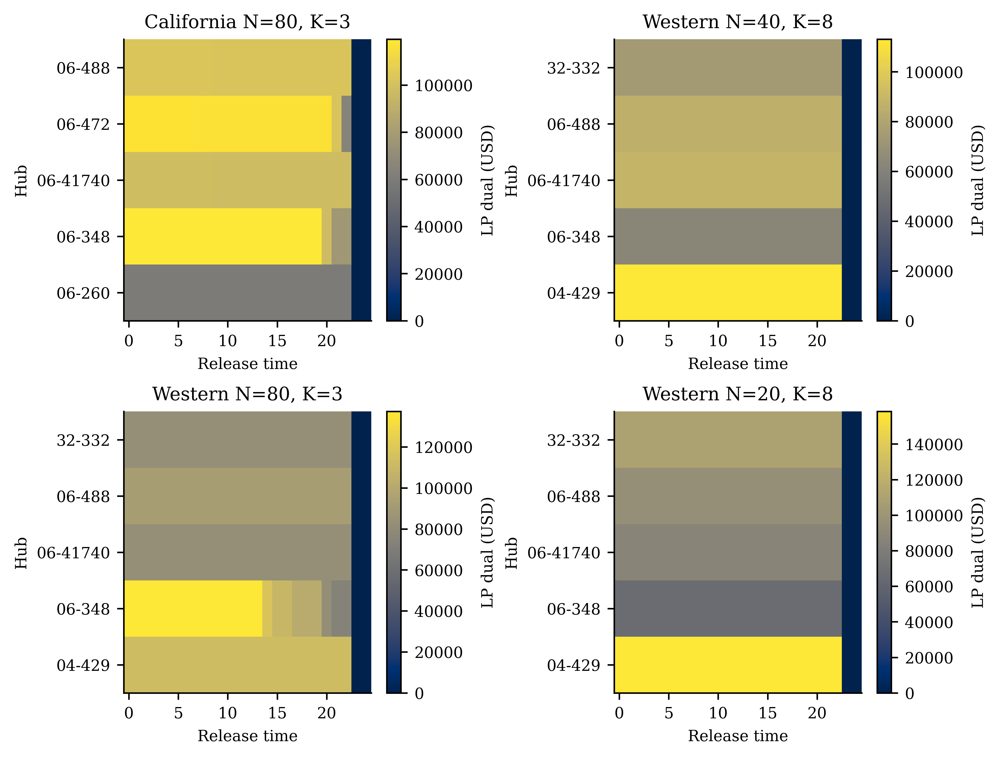

#### 03_chebyshev_coefficient_decay

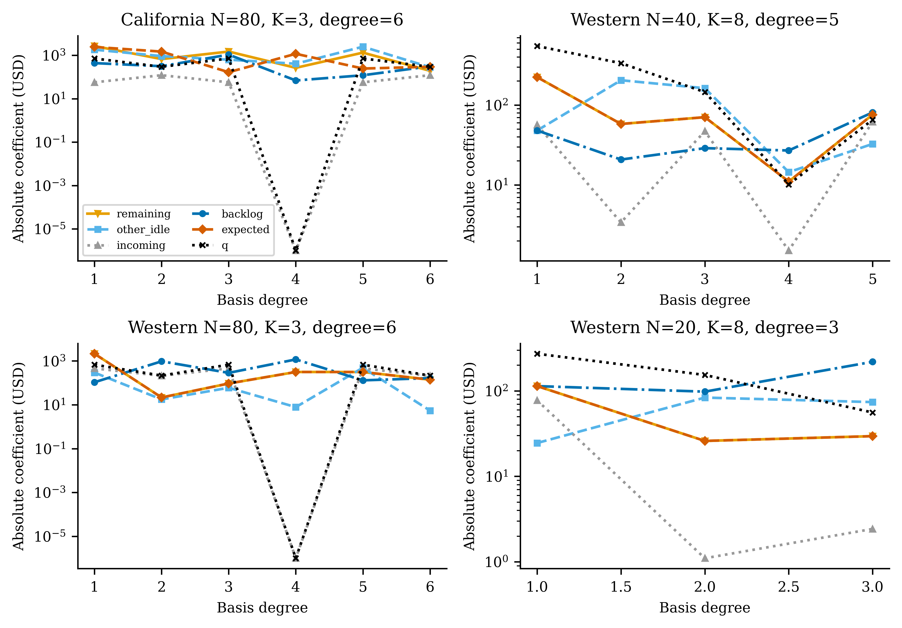

#### 04_runge_stability

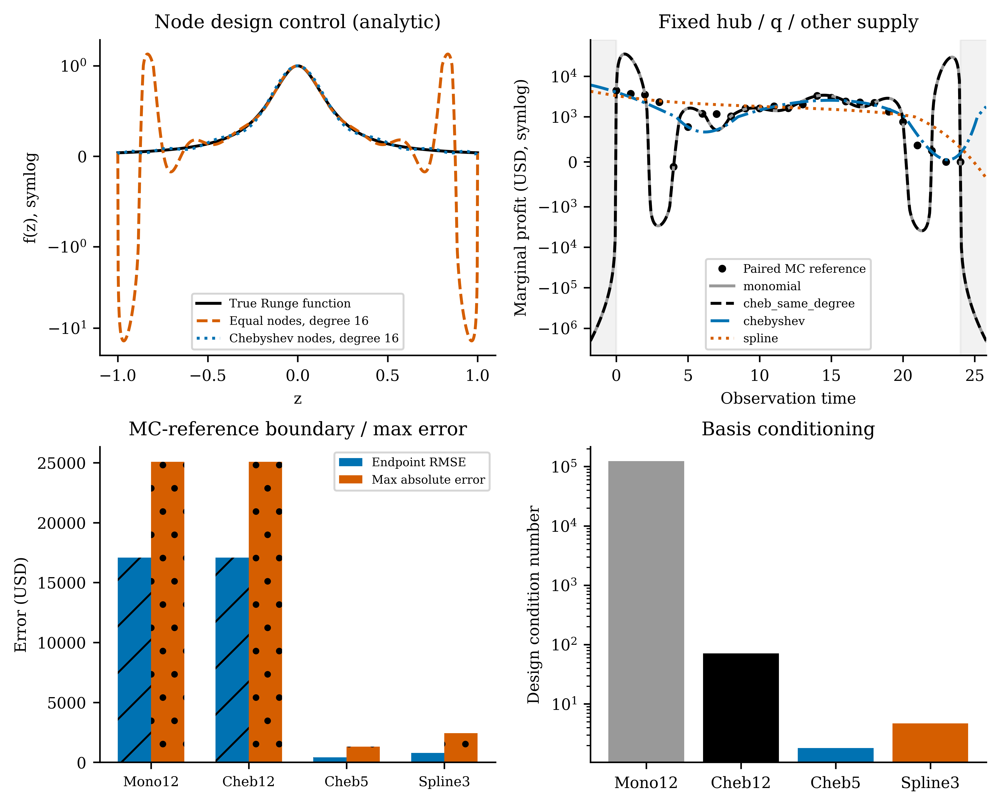

#### 05_spline_components

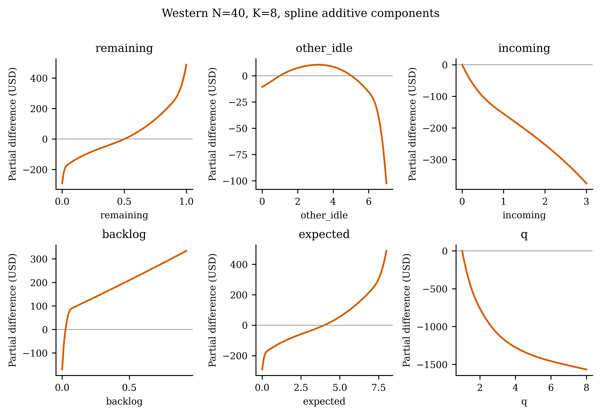

#### 06_heldout_prediction

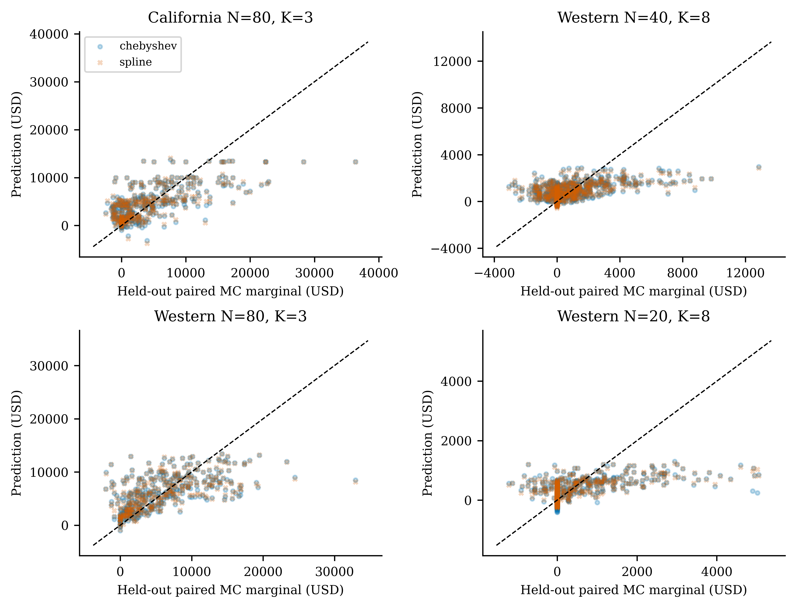

#### 07_policy_ladder_profit

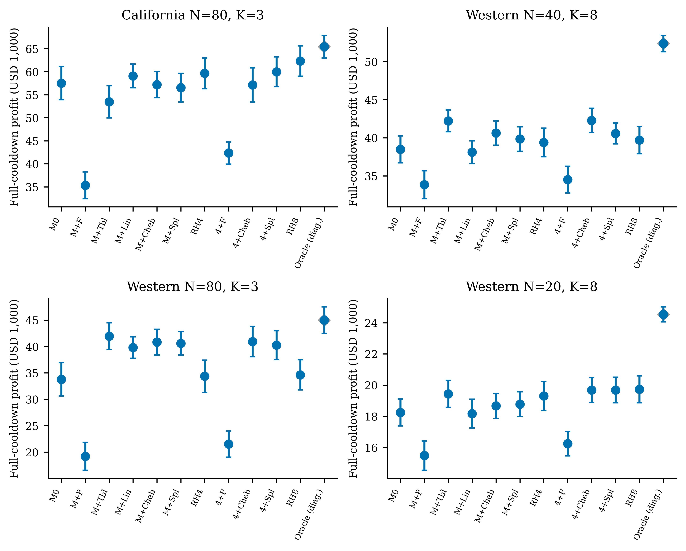

#### 08_terminal_value_vs_RH8

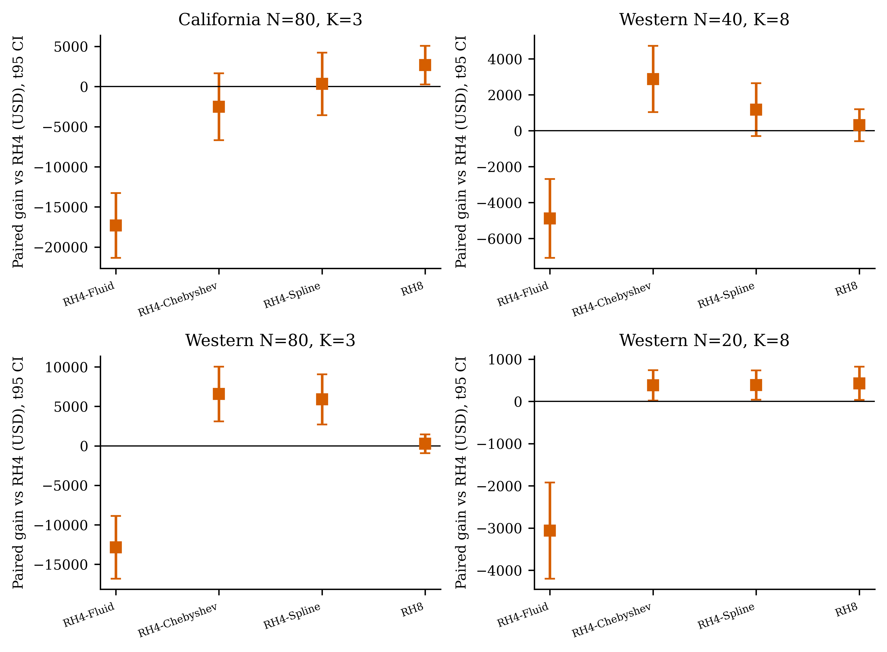

#### 09_oracle_gap_capture

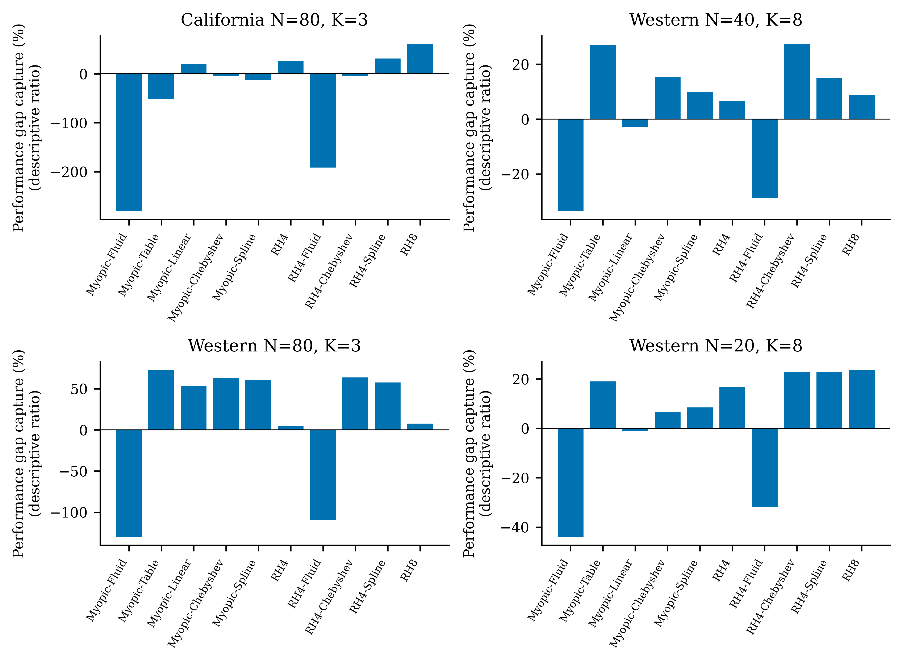

#### 10_runtime_profit_frontier

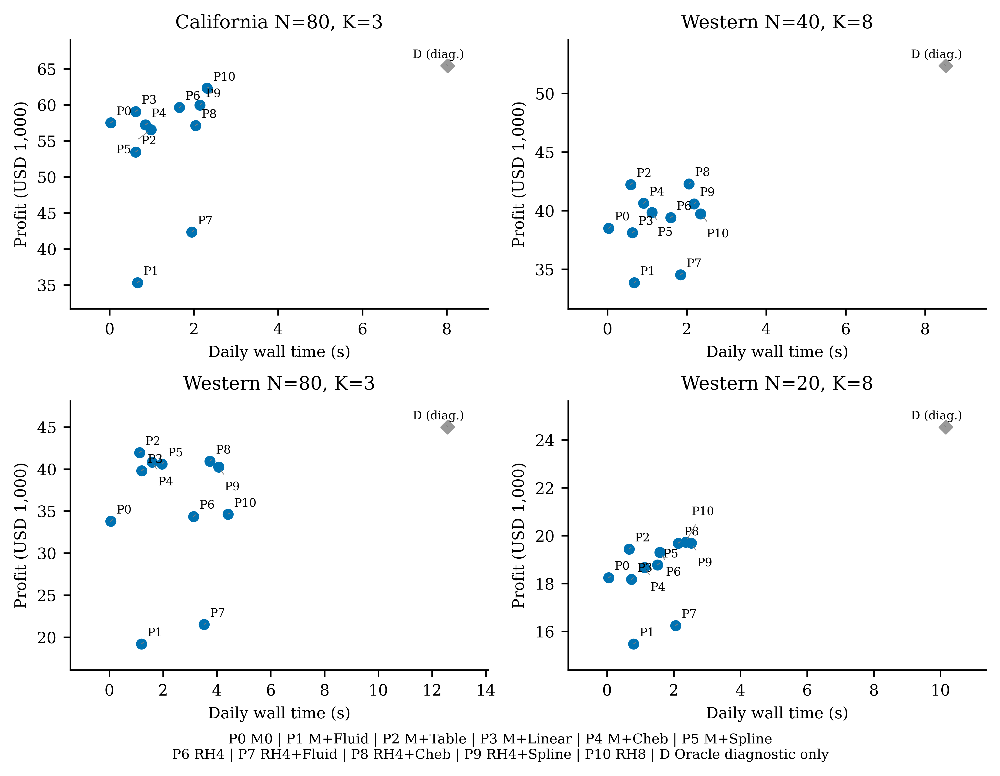

#### 11_supply_slot_shape

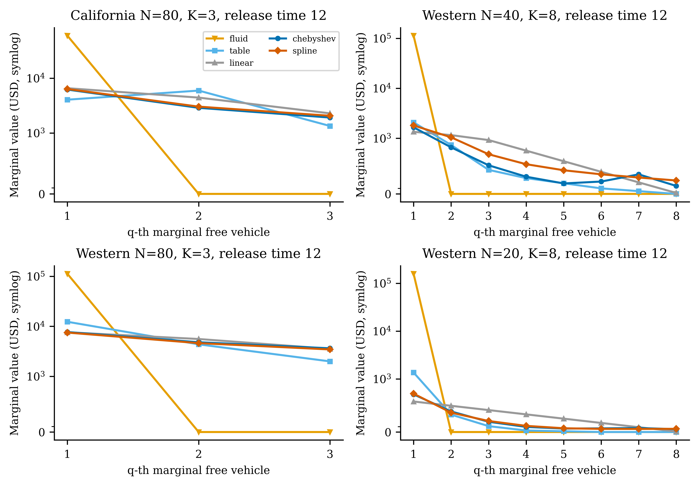

## 13. Implications for legacy DRL

1. 简单classical方法已捕获的收益必须以上面40-seed配对gain/ratio为准；ratio超100%不意味着更多未来信息。RH4与tail有改善时，旧DRL应先与这个合法在线、同预算基准比较。
2. 目前明显非线性候选是资源槽、需求-供给稀缺性、终端/路线完成边界；自然样本与冻结summary混淆使其不能被精确识别。不要把原始非唯一系数当经济因果。
3. Cheb与Spline未得到足以预设某一类函数正则性的统一胜负；局部piecewise结构值得保留对照，但更高阶不是默认方向。
4. 剩余Oracle gap不等于可预测/可学习的收益，更不等于DRL可达到收益；oracle不是全日最优解，且信息不可部署。
5. 当前证据优先支持修正post-decision state/target、少量经济交互与空间摘要。只有这些公平控制仍不足、且独立样本确认可部署预测价值，才评估更高维统计学习，最后考虑neural/DRL。此次不修改或训练旧DRL/SAC与BHH。
