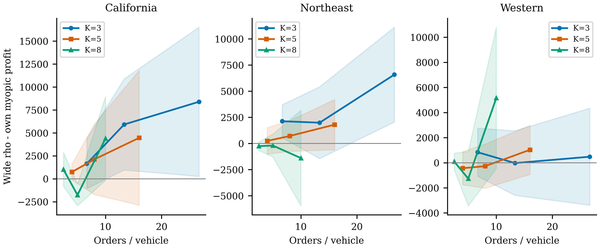
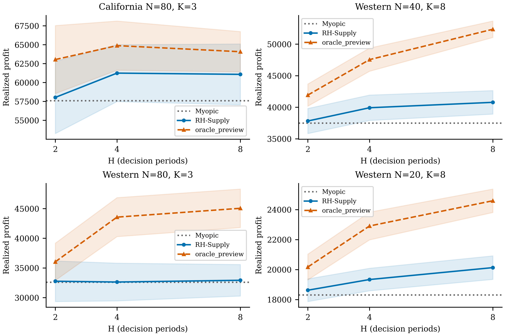
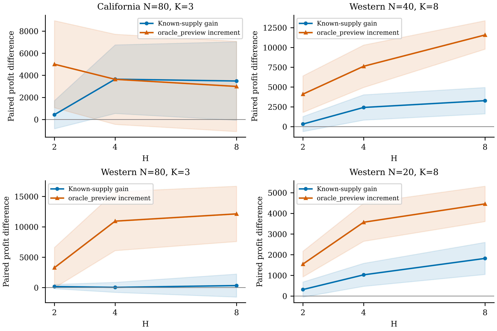
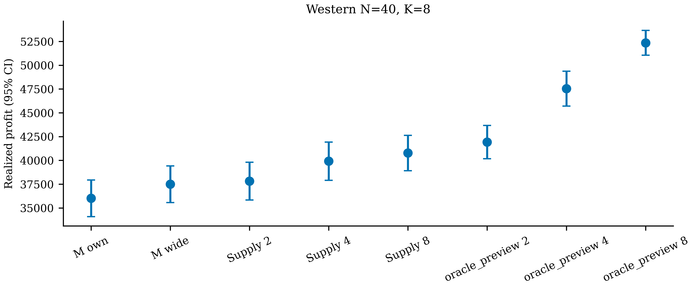
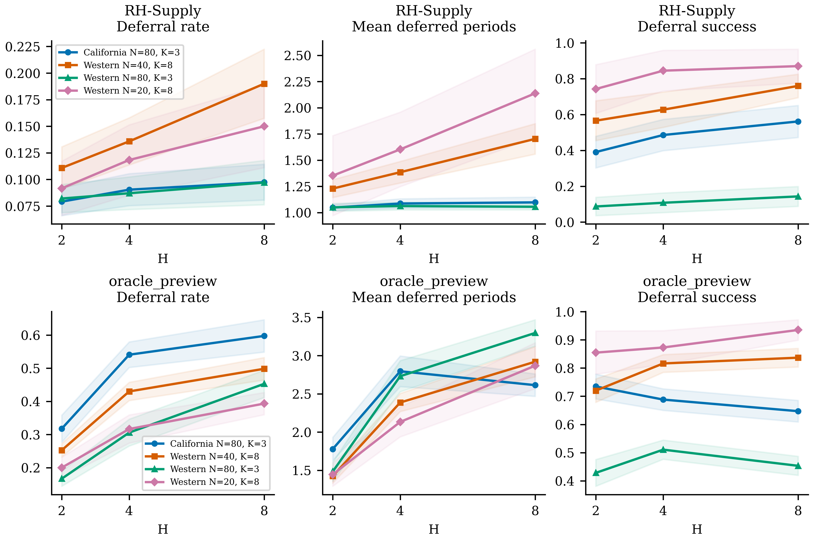
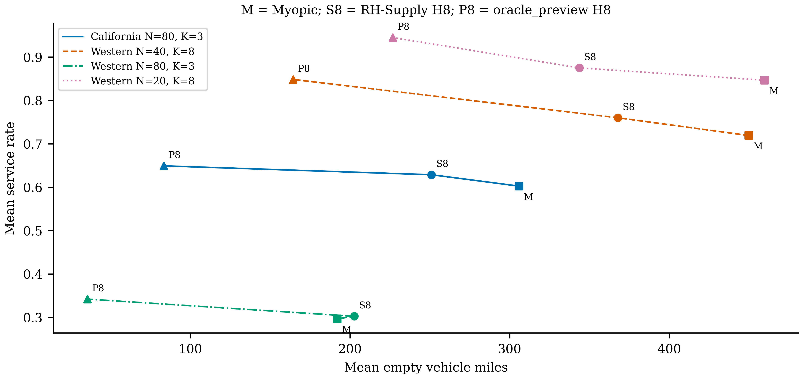
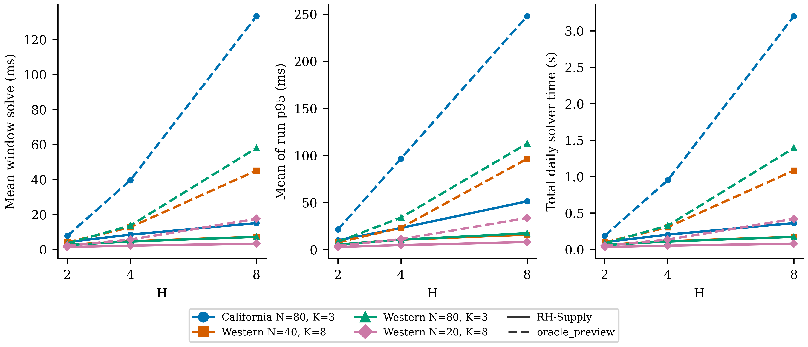

# 第二次数值仿真：压力分区与动态前视基准

所有收益均为 full-cooldown realized profit。RH-Supply 是合法在线信息；**oracle_preview 仅用于未来订单信息放松诊断，不能称可部署策略**。

压力扫描：810 次运行，10 个 paired seeds。正式动态矩阵：2520 次，30 个独立于筛选 pilot 的连续 seeds 1010–1039。失败不删除。

## 1. 基线、数据与压力设计

Phase 0：40次关键基线精确复现旧归档利润，California wide-own +2118.83、Western −275.07，rho0仅own hub；31项前置测试通过。源快照与hash在 phase0/。旧实验输出不覆盖。

同一 CFS adapter、原 WGT_FACTOR 加权无放回抽样、双向OD配平与原坐标/时间/运费假设。CFS货值不是运费，时间不是观测时间，network不是实际公路。不同N是不同实验条件，不是增加replication。

N∈{20,40,80}，K∈{3,5,8}，rho0 / rho_mid / rho_max 取旧报告距离levels，mid取正levels下中位（旧50%分位代表值）。初始车位按完整eligible CFS的outbound WGT_FACTOR总和排序；K3取前三、K5每hub一车、K8再补前三，tie按hub ID，无额外随机源。与旧fleet ID seed-shuffle区分，Phase0复现仍用原冻结fleet。

LA–SF sanity另运行30次（10个paired seeds、3个rho标签），两个正rho的结构重复不当独立样本。与rho0的利润差只在约1e-11数值误差量级，符合两hub sanity预期。

## 2. 算法与信息边界

复用独立 single rolling 模块：联合车辆时空流、路线宏动作、订单和容量；传播当前commitment的future handoff/release，允许等待后匹配；k=1逐期重规划。V=0，无ValueProvider、fluid、学习、RL或multi-backbone。原myopic solver目标不改。

正式进程固定PYTHONHASHSEED=0、Gurobi Seed=0、Threads=1，避免集合约束顺序随worker变化。Pilot默认hash seed，仅作预算验证，不并入正式CI；manifest记录这一区别。

H沿用平台的决策期数：[t,min(t+H,T))。这与任务文档闭区间记号有一个边界差别：H=1是当前单期；preview仍揭示(t,t+H]，但恰在t+H预订的订单没有本窗口决策slot，不得提前分配/接货。未来未booking订单只传给专用窗口接口，绝不提前塞给当前M_t或真实pool。未来batch ready不偷看，仍用当前可见上界。

模型限制：窗口内部把已选路线作为宏动作执行到端点，中间额外接单/延长在下一次真实replan重考虑。故它不是所有逐期M_t动作序列的精确展开，oracle_preview也不是全局最优上界。长路线全段费用和真实deadline计入；T后仅冷却执行承诺，不优化。

known_supply−myopic是“相同在线信息下改用多期规划”的净执行增益，包含当前backlog延期、当前路线联合安排与由这些决策产生的未来车辆复用，并非把外生incoming supply单独作因果识别。若要只识别pipeline信息本身，需要额外的信息屏蔽消融，本轮不虚构这个分解。

Deferral：当前至少存在一个满足pickup/endpoint锚点与逐弧容量的车辆/订单coalition，但本期未分配且未取消，标deliberate_deferral；另分no_vehicle、infeasible_unassignment、cancellation。计数=唯一订单、rate分母=arrivals，periods为累计故意暂缓期数。future_supply_available保守地指原承诺最终idle release可服务该订单；所有中间hub arrivals另完整记录，不能将中途受约束车辆误当自由idle。

每run的mean deferral periods先按该run暂缓订单平均，无暂缓订单的run定义为0，再对run等权汇总。Deferral success rate没有分母时为不适用，统计时保留missing_sample_count，不以0补值，也不与跨seed合并分子的pooled ratio混称。

## 3. 统计口径与筛选

每条件分别报告mean、sample SD、median、Student-t95% CI。差值先按相同seed、相同scenario hash配对；|skew|>1追加固定seed的10000次paired bootstrap percentile CI。Pilot选择最大正向gain、Western最负gain、tight(80/3)、loose(20/8)，重复合并；formal使用新30 seeds，避免筛选样本重复当验证样本。选择规则、角色和pilot gain在representative_regimes.json。

| 角色 | 工况 | pilot wide-own gain |
|---|---|---:|
| positive | California N=80, K=3 | 8393.23 |
| failure | Western N=40, K=8 | -1267.02 |
| tight | Western N=80, K=3 | 481.57 |
| loose | Western N=20, K=8 | 90.79 |

## 4. 正式配对结果（wide rho）

| 工况 | H | 已知供给增益 [t95% CI] | Oracle需求信息增量 [t95% CI] | Supply wide − Myopic own [t95% CI] |
|---|---:|---:|---:|---:|
| California N=80, K=3 | 2 | +437.26 [-836.43, +1710.96] | +5005.75 [+1069.35, +8942.15] | +6020.10 [+1183.88, +10856.31] |
| California N=80, K=3 | 4 | +3649.28 [+544.68, +6753.89] | +3637.46 [-441.16, +7716.09] | +9232.12 [+5163.70, +13300.54] |
| California N=80, K=3 | 8 | +3485.52 [-69.51, +7040.56] | +2994.86 [-1090.57, +7080.30] | +9068.36 [+4623.39, +13513.32] |
| Western N=40, K=8 | 2 | +323.69 [-621.70, +1269.08] | +4105.25 [+1802.55, +6407.95] | +1803.00 [+98.33, +3507.66] |
| Western N=40, K=8 | 4 | +2422.86 [+826.11, +4019.60] | +7625.23 [+4950.17, +10300.29] | +3902.16 [+1790.55, +6013.77] |
| Western N=40, K=8 | 8 | +3280.36 [+1620.04, +4940.67] | +11582.55 [+9785.88, +13379.22] | +4759.66 [+2674.69, +6844.64] |
| Western N=80, K=3 | 2 | +171.61 [-179.37, +522.60] | +3276.17 [-41.87, +6594.21] | +2221.45 [-891.74, +5334.63] |
| Western N=80, K=3 | 4 | +37.33 [-785.10, +859.76] | +10936.69 [+6086.78, +15786.60] | +2087.17 [-876.82, +5051.15] |
| Western N=80, K=3 | 8 | +330.70 [-1558.92, +2220.32] | +12132.83 [+7581.00, +16684.65] | +2380.54 [-1096.89, +5857.96] |
| Western N=20, K=8 | 2 | +313.94 [-49.50, +677.38] | +1547.43 [+926.95, +2167.90] | +901.46 [+219.74, +1583.19] |
| Western N=20, K=8 | 4 | +1025.84 [+470.23, +1581.44] | +3571.73 [+2649.76, +4493.69] | +1613.36 [+971.75, +2254.98] |
| Western N=20, K=8 | 8 | +1820.86 [+1045.08, +2596.63] | +4460.53 [+3606.01, +5315.05] | +2408.38 [+1612.72, +3204.05] |

独立formal seeds的myopic wide−own差值（角色按pilot定义，不强迫formal重现同方向）：

| 工况 | formal Myopic wide−own [t95% CI] |
|---|---:|
| California N=80, K=3 | +5582.83 [+673.75, +10491.91] |
| Western N=40, K=8 | +1479.31 [-350.78, +3309.40] |
| Western N=80, K=3 | +2049.84 [-1055.27, +5154.95] |
| Western N=20, K=8 | +587.53 [-50.47, +1225.53] |

H8直接配对的freedom recovery（wide RH−wide Myopic），两部分区间不能直接相加：

| 工况 | Supply recovery [t95% CI] | oracle_preview recovery [t95% CI] |
|---|---:|---:|
| California N=80, K=3 | +3485.52 [-69.51, +7040.56] | +6480.39 [+753.27, +12207.51] |
| Western N=40, K=8 | +3280.36 [+1620.04, +4940.67] | +14862.90 [+12900.15, +16825.66] |
| Western N=80, K=3 | +330.70 [-1558.92, +2220.32] | +12463.53 [+7307.34, +17619.71] |
| Western N=20, K=8 | +1820.86 [+1045.08, +2596.63] | +6281.39 [+5302.89, +7259.89] |

H8主要差值的完整统计口径（不是混合参数条件的样本）：

| 工况 | 差值 | n | mean | sample SD | median | Student-t95% CI | bootstrap95% CI |
|---|---|---:|---:|---:|---:|---|---|
| California N=80, K=3 | Supply−Myopic | 30 | +3485.52 | 9520.55 | +1138.70 | [-69.51, +7040.56] | 未触发偏态规则 |
| California N=80, K=3 | oracle_preview−Supply | 30 | +2994.86 | 10941.00 | +2993.60 | [-1090.57, +7080.30] | 未触发偏态规则 |
| Western N=40, K=8 | Supply−Myopic | 30 | +3280.36 | 4446.40 | +2337.39 | [+1620.04, +4940.67] | 未触发偏态规则 |
| Western N=40, K=8 | oracle_preview−Supply | 30 | +11582.55 | 4811.57 | +10485.84 | [+9785.88, +13379.22] | 未触发偏态规则 |
| Western N=80, K=3 | Supply−Myopic | 30 | +330.70 | 5060.50 | +0.00 | [-1558.92, +2220.32] | 未触发偏态规则 |
| Western N=80, K=3 | oracle_preview−Supply | 30 | +12132.83 | 12190.02 | +11273.20 | [+7581.00, +16684.65] | 未触发偏态规则 |
| Western N=20, K=8 | Supply−Myopic | 30 | +1820.86 | 2077.56 | +1035.39 | [+1045.08, +2596.63] | [+1143.27, +2620.47] |
| Western N=20, K=8 | oracle_preview−Supply | 30 | +4460.53 | 2288.45 | +4115.42 | [+3606.01, +5315.05] | 未触发偏态规则 |

## 5. 研究问题逐项回答

Q1（压力是否主因）：逐区域压力map见图1与regime_map_paired.csv；以下仅描述各条件的均值，不把27个不同条件当独立场景混算CI。

- California：9个压力条件中1个mean gain负；tight +8393.23 [+267.82, +16518.64]，loose +1014.27 [-844.75, +2873.29]。供需压力与空间配置同时变化，不能仅凭这个map断言因果。
- Northeast：9个压力条件中3个mean gain负；tight +6581.25 [+2045.07, +11117.42]，loose -253.91 [-665.81, +157.99]。供需压力与空间配置同时变化，不能仅凭这个map断言因果。
- Western：9个压力条件中4个mean gain负；tight +481.57 [-3383.85, +4346.99]，loose +90.79 [-572.15, +753.73]。供需压力与空间配置同时变化，不能仅凭这个map断言因果。

本轮不支持“failure主要集中于tight supply”的概括：三个区域80/3的pilot平均gain均非负；所选Western最负pilot为40/8（5 orders/vehicle），不是80/3（26.67 orders/vehicle）。且formal未稳定重现该负向差值，空间配置/参数/场景交互不能用单一N/K解释。

Q2/Q3（信息分解）：上表分别给known_supply−myopic、oracle_preview−known_supply。有限H、零terminal value和宏动作限制下，后者可能为负；它是同一规划器不同信息的执行差值，不是信息理论非负价值定理。

H8下，Western20/8和40/8的在线Supply增益CI下界>0，80/3则跨0；三个Western工况的oracle额外增益都显著高于0（逐项marginal区间）。因此仅known-supply结构不能解释本矩阵全部动态改善，但oracle潜力不能当作可预测、可学习或可部署的保证。

Q4（Western是否修复）：
该pilot-selected failure工况在新formal seeds下Myopic wide−own=+1479.31 [-350.78, +3309.40]。formal平均不再负向；本轮不能声称已在独立样本可靠复现负向failure。

- H=2：Supply wide相对Myopic own为+1803.00 [+98.33, +3507.66]；CI下界大于0，支持超过own对照；但formal myopic均值本身未退化，不称修复负向failure。
- H=4：Supply wide相对Myopic own为+3902.16 [+1790.55, +6013.77]；CI下界大于0，支持超过own对照；但formal myopic均值本身未退化，不称修复负向failure。
- H=8：Supply wide相对Myopic own为+4759.66 [+2674.69, +6844.64]；CI下界大于0，支持超过own对照；但formal myopic均值本身未退化，不称修复负向failure。

Q5（是否H2/4饱和）：不预设单调或饱和。H4−H2、H8−H4的配对统计保存于horizon_increments.csv。H4/H8增益比例仅在H8平均增益>0时有描述意义；超过100%可能说明非单调，不表示精确等价。

| 工况 | Supply H4 / H8 mean gain | Supply H8−H4 [t95% CI] | Oracle H8−H4 [t95% CI] |
|---|---:|---:|---:|
| California N=80, K=3 | 104.7% | -163.76 [-1982.43, +1654.91] | -806.36 [-3929.08, +2316.37] |
| Western N=40, K=8 | 73.9% | +857.50 [-90.57, +1805.57] | +4814.82 [+2981.05, +6648.59] |
| Western N=80, K=3 | 11.3% | +293.37 [-1367.02, +1953.76] | +1489.51 [-1693.49, +4672.51] |
| Western N=20, K=8 | 56.3% | +795.02 [+217.54, +1372.50] | +1683.83 [+1014.78, +2352.88] |

有限H、终端V=0和后续重规划下，增大H并不保证全天利润单调；CI跨0不能证明饱和或等价。

Q6（机制）：下面是Supply H8相对myopic wide的配对变化。服务率和空驶应联合解释；暂缓是按可行性记录的operational行为，不证明优化器有意将每个订单安排到未来，低价值拒绝也可能在取消前被计入该口径。

| 工况 | Δservice rate [CI] | Δempty miles [CI] | Δcross pickup miles [CI] |
|---|---:|---:|---:|
| California N=80, K=3 | +0.0263 [-0.0023, +0.0548] | -54.88 [-103.74, -6.01] | -54.88 [-103.74, -6.01] |
| Western N=40, K=8 | +0.0408 [+0.0222, +0.0594] | -81.90 [-217.35, +53.55] | -81.90 [-217.35, +53.55] |
| Western N=80, K=3 | +0.0058 [-0.0039, +0.0155] | +10.75 [-48.87, +70.36] | +10.75 [-48.87, +70.36] |
| Western N=20, K=8 | +0.0283 [+0.0116, +0.0451] | -116.03 [-200.94, -31.12] | -116.03 [-200.94, -31.12] |

service、wait、occupancy、deferral和pipeline详见图5/6与完整机制CSV。空间分布的期末车辆逐t状态可审计，但本轮不声称已把空间平衡效应因果分解。case只作轨迹解释，不能把事后挑选seed当总体证据。

Q7（是否值得继续RL）：
4类代表工况（合并后4类）H8中，3类的oracle额外增益CI下界>0，0类CI上界<0。
Recommendation：存在需进一步研究需求预测/价值逼近的工况，但先校准未来需求与terminal effects，验证宏动作限制和计算预算。Oracle gap不是可学习性证据，暂不直接启动复杂RL。必须要求未来方法在同信息、同预算下超过RH-Supply，而不是与oracle混称可部署收益。

上述CI都是各个预先规定比较的marginal区间，未作多重比较控制；整组显著性不能由单个CI拼接宣称。正式新seed降低工况筛选的重复使用偏差，但研究仍为机制探索，不是全国经营效果的confirmatory trial。

## 6. Seven figures

### Myopic regime map

### Horizon vs realized profit

### Future-information decomposition

### Western freedom recovery

### Deferral behavior

### Empty mileage vs service rate

### Runtime scaling

## 7. Runtime、失败与验收

正式运行2520次；失败0；有非OPTIMAL可行解的窗口数=0。全部承诺完成。窗口gap不是全天gap；timeout、status、变量/约束规模逐run保存。运行时间含构建、执行、审计和输出开销，求解器runtime单独记录。

图7的p95先对每run的window runtime取95%分位，再对30个run等权平均；并非把所有windows混在一起算global p95。每日solver time是求解器runtime之和，daily wall time另存CSV。3个仿真worker并行、各Gurobi一线程；耗时受本机调度影响，不作为独立于硬件的速度保证。

Run wall time包含本次执行、审计和输出，不包含父进程最初的CFS读取/场景冻结；manifest各stage elapsed也从冻结后开始计时，不等于脚本从启动到退出的全部耗时。

独立读取原始trace审计：4248次run、166993个时点，结果PASSED。核对冻结数据/spec/source hash、物理invariants、booking边界、无提前/重复assignment、Supply无preview、oracle区间、k=1与realized利润恒等式；逐trace SHA在processed/trace_audit.json。

Canonical tests A–E、车位确定性、booking边界、ETA更新测试通过。Full-preview与H1小样本诊断单独保存，不并入30-seed正式均值。所有先验规则写config，未挑formal seed，未删除失败样本。

整套回归在正式固定环境PYTHONHASHSEED=0下107项通过；另有一条Starlette/AnyIO弃用warning。默认hash环境的一次全套运行104通过/1失败：Test C在零等待/积压成本下强制‘立即服务’，而‘稍后服务’也是相同window最优目标，断言对tie敏感。为保持冻结源码身份，本轮没有中途改写该fixture；未来应检查window目标与可行性而非强制一个非唯一动作。首次失败与重测都保存在processed/qa_validation.json，不以固定环境通过掩盖这一测试局限。

另在独立临时目录重跑California N80/K3、seed1010、wide rho、oracle_preview H8，利润差0，逐期状态/动作轨迹完全一致；原正式run未覆盖。

### H=1 与全日预览：独立诊断，不计入正式CI

每工况/半径只使用两个既定seed 1010、1011。以下是小样本描述，不用作总体显著性结论。

| 诊断 | 工况 | rho | mean配对profit差 | 两seed差值范围 |
|---|---|---|---:|---:|
| Supply H1 − Myopic | California N=80, K=3 | rho0 | +0.00 | [+0.00, +0.00] |
| Supply H1 − Myopic | California N=80, K=3 | rho_mid | +0.00 | [+0.00, +0.00] |
| Supply H1 − Myopic | California N=80, K=3 | rho_max | +0.00 | [+0.00, +0.00] |
| Supply H1 − Myopic | Western N=20, K=8 | rho0 | -0.00 | [-0.00, +0.00] |
| Supply H1 − Myopic | Western N=20, K=8 | rho_mid | -0.00 | [-0.00, +0.00] |
| Supply H1 − Myopic | Western N=20, K=8 | rho_max | -0.00 | [-0.00, +0.00] |
| Supply H1 − Myopic | Western N=40, K=8 | rho0 | -0.00 | [-0.00, -0.00] |
| Supply H1 − Myopic | Western N=40, K=8 | rho_mid | -0.00 | [-0.00, +0.00] |
| Supply H1 − Myopic | Western N=40, K=8 | rho_max | -0.00 | [-0.00, +0.00] |
| Supply H1 − Myopic | Western N=80, K=3 | rho0 | +0.00 | [+0.00, +0.00] |
| Supply H1 − Myopic | Western N=80, K=3 | rho_mid | +0.00 | [+0.00, +0.00] |
| Supply H1 − Myopic | Western N=80, K=3 | rho_max | +0.00 | [+0.00, +0.00] |
| oracle_preview full − H8 | California N=80, K=3 | rho0 | +23273.53 | [+15145.39, +31401.66] |
| oracle_preview full − H8 | California N=80, K=3 | rho_mid | +18971.62 | [+17714.19, +20229.04] |
| oracle_preview full − H8 | California N=80, K=3 | rho_max | +18971.62 | [+17714.19, +20229.04] |
| oracle_preview full − H8 | Western N=20, K=8 | rho0 | +50.36 | [+5.00, +95.72] |
| oracle_preview full − H8 | Western N=20, K=8 | rho_mid | +658.02 | [+144.64, +1171.40] |
| oracle_preview full − H8 | Western N=20, K=8 | rho_max | +658.02 | [+144.64, +1171.40] |
| oracle_preview full − H8 | Western N=40, K=8 | rho0 | +4393.08 | [+4010.46, +4775.71] |
| oracle_preview full − H8 | Western N=40, K=8 | rho_mid | +3880.91 | [+3751.37, +4010.46] |
| oracle_preview full − H8 | Western N=40, K=8 | rho_max | +3880.91 | [+3751.37, +4010.46] |
| oracle_preview full − H8 | Western N=80, K=3 | rho0 | +5624.72 | [+3139.25, +8110.20] |
| oracle_preview full − H8 | Western N=80, K=3 | rho_mid | +4446.18 | [+3139.25, +5753.10] |
| oracle_preview full − H8 | Western N=80, K=3 | rho_max | +4446.18 | [+3139.25, +5753.10] |

两类诊断合计48次run，非OPTIMAL可行窗口数=0，最大window gap=0。

H1逐期真实前状态重放：576期；相同状态下H1与原myopic augmented objective的最大绝对差=3.6379788e-12。
单期最优解可能非唯一；H1采用不同变量/约束顺序，最优目标一致不保证选同一车辆、延迟或路线。此类tie会使后续状态分叉，故不能从H1全天差值直接断言信息泄漏。逐期目标检查详见processed/H1_same_state_objectives.csv。

## 8. Western轨迹

### Western case：N=40, K=8, seed=1010

按最大wide-rho动态改善自动选取，仅作事后机制例，不代表平均收益。

Myopic wide最终profit=29777.52；oracle_preview H=4为57995.75，差值=+28218.23。首个动作分歧t=0。

在t=4出现cross-hub动作分歧：Myopic执行[{'order_id': 'cfs-24893034', 'vehicle_id': '1'}, {'order_id': 'cfs-32446436', 'vehicle_id': '3'}, {'order_id': 'cfs-04210935', 'vehicle_id': '3'}, {'order_id': 'cfs-31323790', 'vehicle_id': '4'}]，其路线为[('1', '32-332', '06-488'), ('2', '06-41740', '04-429'), ('3', '06-488', '06-41740'), ('4', '32-332', '04-429')]；备选策略执行[{'order_id': 'cfs-04210935', 'vehicle_id': '3'}, {'order_id': 'cfs-32446436', 'vehicle_id': '3'}, {'order_id': 'cfs-24893034', 'vehicle_id': '4'}, {'order_id': 'cfs-21444149', 'vehicle_id': '5'}, {'order_id': 'cfs-31323790', 'vehicle_id': '5'}]。

原myopic本期booked profit=4226.90，固定承诺继续、其余等待的可行动作为-20.00，单期优势=+4246.90。这是局部booked比较，不是对最终realized目标的上界。

Myopic当时已知incoming supply=[{'committed_order_ids': ['cfs-20515834', 'cfs-21444149'], 'eta': 7, 'hub': '06-348', 'idle_release': False, 'vehicle_id': '2'}, {'committed_order_ids': ['cfs-35434553'], 'eta': 9, 'hub': '32-332', 'idle_release': False, 'vehicle_id': '0'}, {'committed_order_ids': ['cfs-09482658', 'cfs-11788739'], 'eta': 10, 'hub': '32-332', 'idle_release': False, 'vehicle_id': '6'}, {'committed_order_ids': ['cfs-20515834', 'cfs-21444149'], 'eta': 13, 'hub': '32-332', 'idle_release': False, 'vehicle_id': '2'}, {'committed_order_ids': ['cfs-35434553'], 'eta': 15, 'hub': '06-348', 'idle_release': False, 'vehicle_id': '0'}, {'committed_order_ids': ['cfs-09482658', 'cfs-11788739'], 'eta': 16, 'hub': '06-348', 'idle_release': False, 'vehicle_id': '6'}, {'committed_order_ids': ['cfs-35434553'], 'eta': 18, 'hub': '06-41740', 'idle_release': True, 'vehicle_id': '0'}, {'committed_order_ids': ['cfs-09482658', 'cfs-11788739'], 'eta': 19, 'hub': '06-41740', 'idle_release': True, 'vehicle_id': '6'}, {'committed_order_ids': ['cfs-20515834', 'cfs-21444149'], 'eta': 20, 'hub': '04-429', 'idle_release': True, 'vehicle_id': '2'}]；备选策略的暂缓审计=[{'deferral_periods': 2, 'deferral_reason': 'deliberate_deferral', 'eventual_serving_vehicle': '2', 'future_supply_available': False, 'future_supply_eta': None, 'future_supply_vehicle_ids': [], 'order_id': 'cfs-20515834', 'period': 4}]。

该cross分歧前状态已不同，是此前控制的累积后果，不能将全天gain归因于该一期cross决策。

| 策略 | delivered | empty miles | cross pickup miles | deliberate deferred orders | mean deferral periods |
|---|---:|---:|---:|---:|---:|
| myopic H=0 | 25 | 275.13 | 275.13 | 1 | 1.00 |
| oracle_preview H=4 | 37 | 275.13 | 275.13 | 17 | 2.06 |

该案例空驶总量相同，但服务订单由25增至37，与更高完成收入一致；不支持将该seed的收益主要解释为减少empty deadhead。前期暂缓、后续配载与车辆时序共同变化，不能从一条事后选中的轨迹识别单一因果机制。

完整逐期CSV含open orders、车辆、incoming pipeline、候选动作（最多12条显示，truncation flag显式）、选择、空驶、deferral和后续realized结果。每期全部当前cross候选已由两个策略的真实前状态重放枚举，保存在raw/case-candidates/western-all-periods.json，并通过CSV路径引用。重放先独立验证动作/账本金额误差不超过1e-6，再沿用记录的booked monetary scalars，以避免约1e-12累加顺序误差使严格state hash失配；不覆盖物理状态或原始trace。按seed最大改善选例具有选择偏差，正式CI不依赖该案例。

## 9. 可复现文件

- raw/datasets：完整冻结数据与observed/generated记录；raw/runs：spec、hash、metrics、逐t trace、dual ledger、状态。
- summary.csv：每条件/指标完整统计；paired_differences.csv：信息分解、恢复与机制统计；horizon_increments.csv：H差值；processed/diagnostics.csv：H1/full-preview小样本。
- manifest.json：config、baseline config/hash、code SHA逐文件/快照、CFS SHA、Python/solver版本、运行数量、seed、protected files。
- processed/plotting_config.json：图尺寸、字体、颜色/符号、统计定义及输入hash；traces/western_case.csv与western_case.md：可读案例。
- analysis-source.snapshot.zip：后处理脚本独立快照；不因调整报告文本而将旧数值输出假称新运行。

复现：先运行run_regime_map，再run_rolling_horizon --pilot，再run_rolling_horizon，最后analysis。同运行源码/config/CFS身份可续跑；改引擎必须新output。旧基线source snapshot在phase0。

限制：货运shipment不是passenger，每条被当作不可分割load；不同seed可重抽同一PUMS记录，CI为生成场景replication不包含调查误差。坐标、几何网络、时间、运费和成本都是原实验假设。Formal按pilot选择工况，不能外推全部27条件。所有oracle图明确标识信息放松，不称可部署或full-horizon最优。
