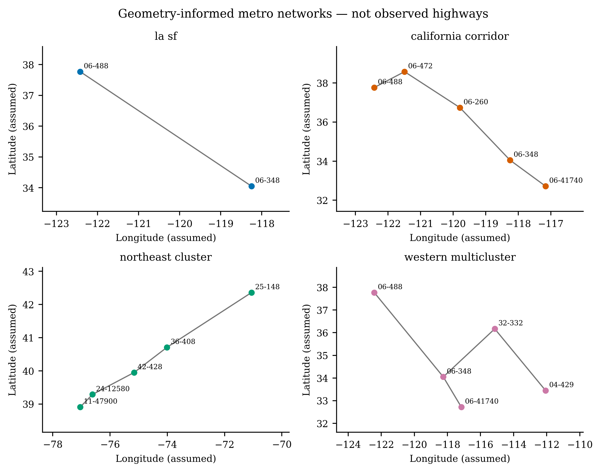
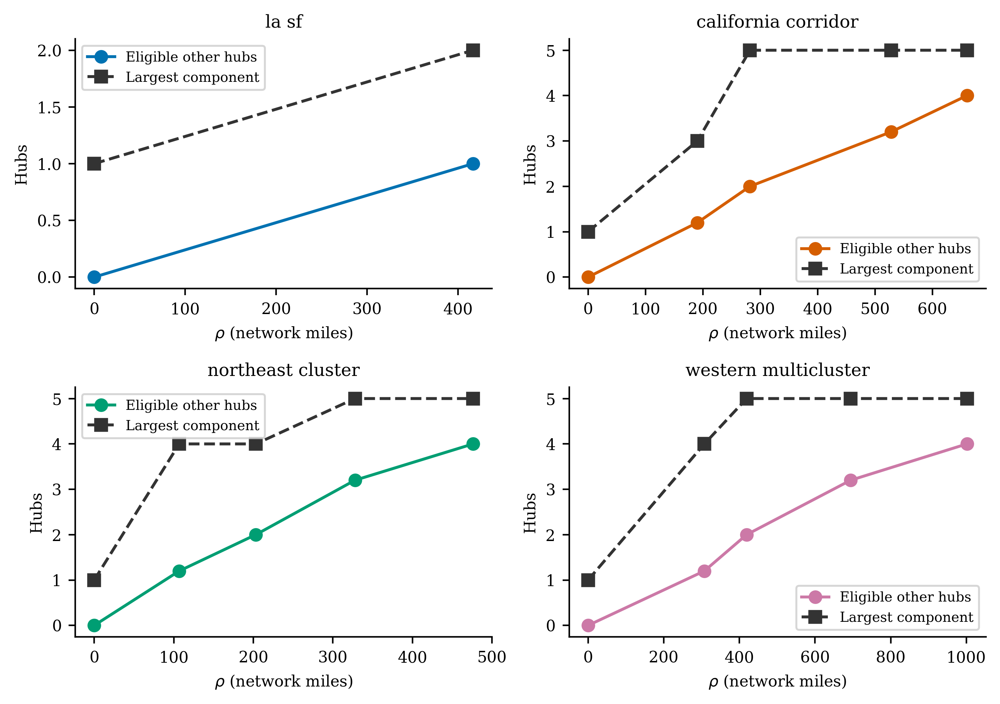
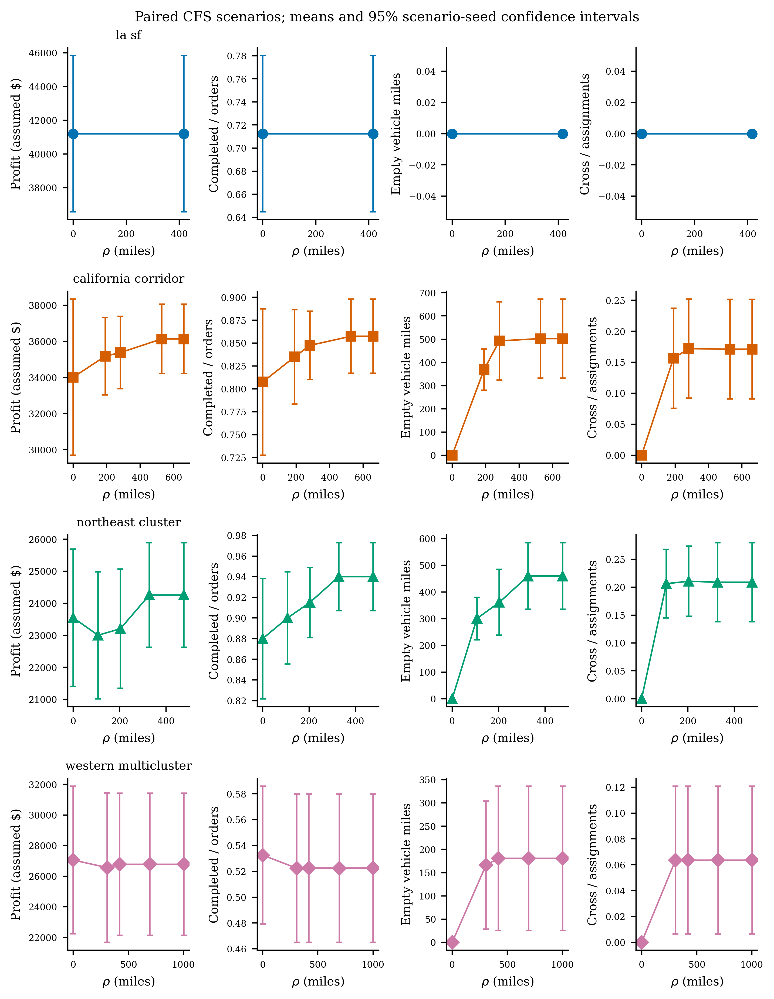
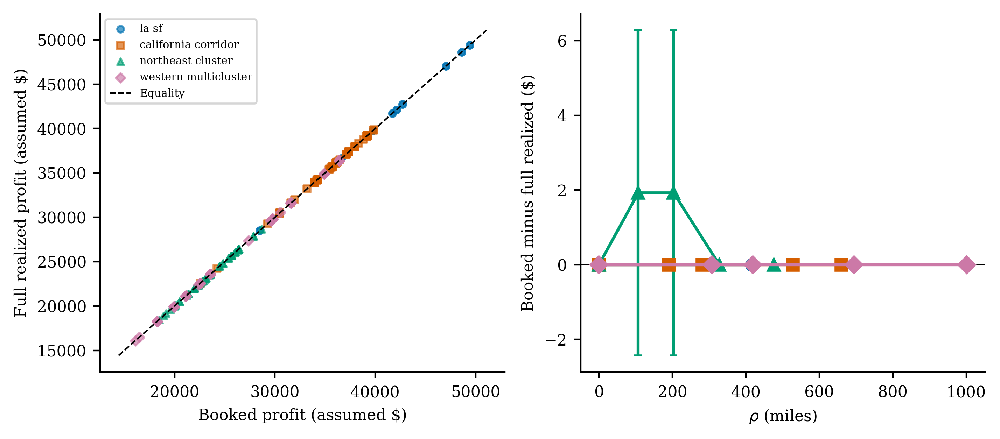
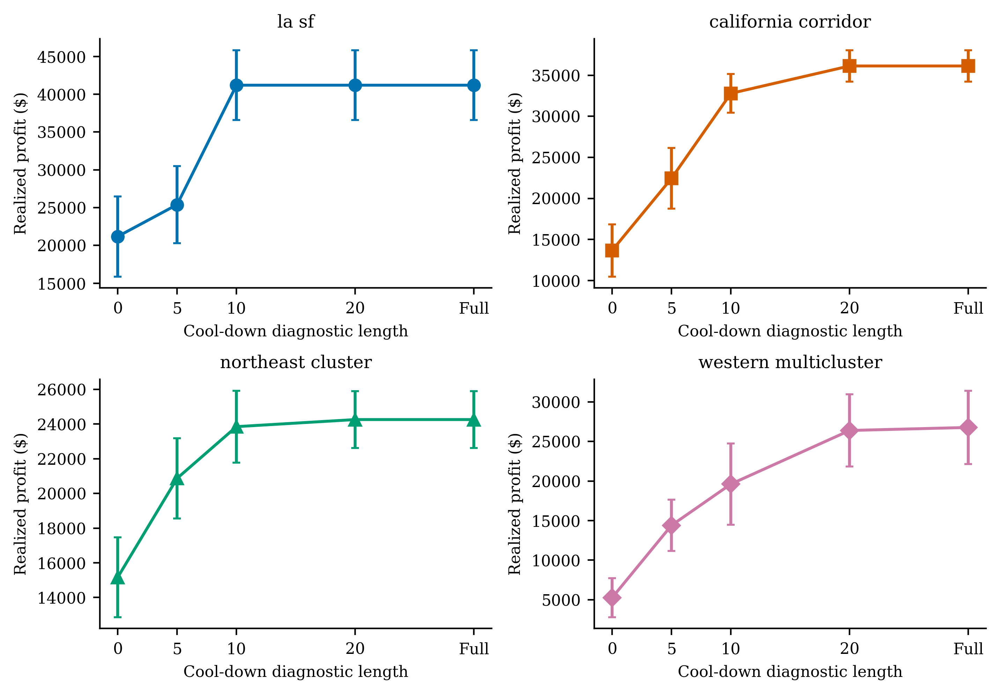
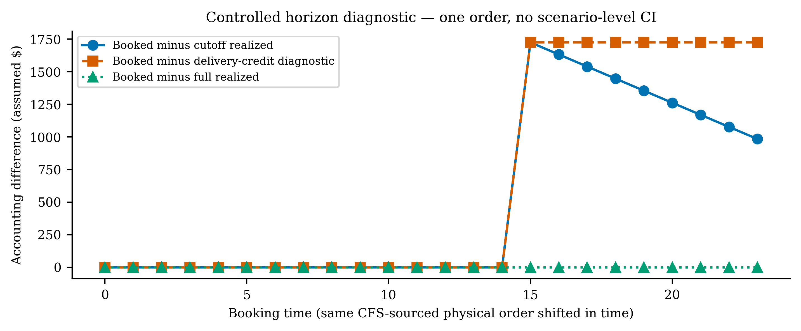
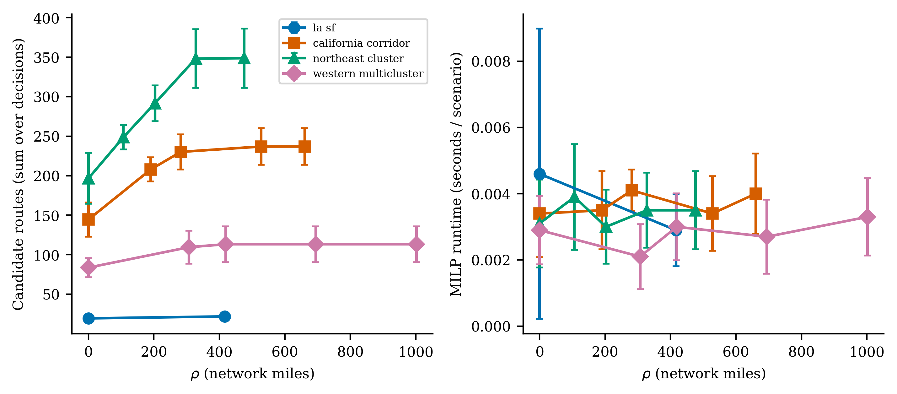

# CFS network-rho 与日终真实核算仿真实验报告

日期：2026-10-04。统计及图表全部由 `experiments/cfs_rho_endofday/analysis.py` 从原始运行结果生成。正式实验状态：COMPLETED。

## 1. Executive Summary

完成 40 个配对 CFS 场景、210 次正式运行，每个条件 10 个连续种子，每场景 40 个订单。网络距离/rho 规则通过多跳/长边/零半径/单调/固定路径测试；纯执行冷却期完成全部承诺，没有日终再次优化。

在 T 截止时，每次运行平均仍有 11.70 个已分配未交付订单；正式结果全部 unfinished committed=0。booked−full-realized 的条件混合平均为 0.18（仅描述性，不作为独立样本 CI）。**提前收入的截止偏差被消除，但 booked−full-realized 不一定为正**：计划 backbone 全段按 loaded_cost 计费，而实际按占载/空载区分，两种成本口径本身也可能不同。

Go：以 d_G≤rho 作为正式资格，adjacency 只作显式诊断。Go：以后论文比较采用 full-cooldown realized_profit；旧指标保留供复现，不能把 booked objective 当实际利润。收益提升不是预设结论，见逐区域配对 CI。

## 2. Data：观测值与生成值

唯一源：`D:\mycodelife\workshop\Intercity_Delivery_System_Design\data\cfs_2022_pums.sqlite`；CFS 2022 PUMS indexed SQLite，4,914,769,920 bytes，mtime_ns=1787017182604895800；完整 SHA256 `c74292117a81082582f26bb1c54618f84e4248b58389280f04a3fb3f8e6236f2`。SQLite metadata 声明 37,576,546 shipments；此次只读查询局部 OD，未下载/替换源文件。

参考本地 Intercity 分支 `agent/paper-solution-approaches`，commit `a0076597899950722b114a8e5127f36992f498a8`。适配 catalog area code、SQLite schema/index、双向筛选、log(U)/WGT_FACTOR 加权 reservoir；reference 四个文件 hash 见 manifest。未复制其业务模型或截断时间窗。

过滤：MODE∈{111 for-hire truck,112 company-owned truck}；domestic N；不同明确 metro；weight∈(0,40000] lbs；大圆距离≥50 miles；WGT_FACTOR>0；每一方向至少 10 条。超过容量的整单排除，不裁剪货重。每对方向均衡分配实验订单，再在每个 OD stratum 内按 WGT_FACTOR 加权无放回抽样。**跨 OD 均衡设计不是全国自然 OD 分布，也不是无偏 survey total 估计。**

| 分类 | 字段/解释 |
|---|---|
| CFS observed | shipment ID, origin/destination CFS area, weight/lbs, goods value/$, great-circle distance/miles, mode, SCTG, TEMP_CNTL, EXPORT, HAZMAT, WGT_FACTOR |
| generated | booking uniform 0..23，ready=booking+0..2，deadline=ready+network travel+4..8；不截到 T |
| model scale | load=ceil(weight/1000 lbs)，容量40单位；无拆单/裁剪 |
| assumed tariff | fare=4×network OD miles+0.03×weight lbs；**不是 CFS goods value 或观测运费** |
| assumed costs | occupied $2/mile，empty $2.2/mile，backlog $5/order-period，expiry $100/order，vehicle wait $0/period |
| generated network/fleet | 近似代表城市坐标、kNN/MST、stretch1.2、每 hub 一辆；不是观测场站、道路、车辆 |

以上 temporal fields 是基于 CFS 抽样需求构造的模型时间假设，不是 CFS observed timestamps，也未以实际货运时间标定。用户指南第2/3/5/8/9页：货值不是运费；2022只给大圆距离、不提供 routed mileage；survey weight含采样/噪声调整。

| 区域 | CFS areas / 代表位置 | 支持双向 OD 数 | rho levels (miles) |
|---|---|---:|---|
| la_sf | 06-348: Los Angeles-Long Beach CA; 06-488: San Jose-San Francisco-Oakland CA | 1 | 0.00, 416.59 |
| california_corridor | 06-260: Fresno; 06-348: Los Angeles; 06-41740: San Diego; 06-472: Sacramento; 06-488: San Francisco | 10 | 0.00, 190.49, 282.17, 527.98, 660.30 |
| northeast_cluster | 11-47900: Washington DC part; 24-12580: Baltimore; 25-148: Boston MA part; 36-408: New York NY part; 42-428: Philadelphia PA part | 7 | 0.00, 106.84, 203.11, 327.72, 476.20 |
| western_multicluster | 04-429: Phoenix; 06-348: Los Angeles; 06-41740: San Diego; 06-488: San Francisco; 32-332: Las Vegas | 10 | 0.00, 307.43, 419.13, 694.26, 1001.69 |

完整方向计数在 manifest.data_regions；不满足最低双向数量的 pair 排除（例如 DC–NY），没有虚构 OD。每个场景 `raw/*.source.json` 保存全部抽中观测字段及对应生成订单。

冻结场景总抽样记录数（重复抽中计数）=1600；去重源shipment ID=1058。不同seed可抽中同一PUMS记录，不能声称全部观测样本互不重叠。

## 3. Network Construction

CFS areas → 配置中近似代表城市 lat/lon（非 area centroid）→ 区域局部 equirectangular 投影/英里 → deterministic kNN(k=1)+MST 保证连通 → edge length=1.2×投影欧氏距离 → Dijkstra d_G → own hub + {v≠u:d_G≤rho}。stretch 是 geometry-based 假设。无真实 highway 数据，全部称 **geometry-informed metro network**。东北区是相对稠密的 metro 子集，不声称20英里城市设施密集网络；20英里多跳逻辑另由明确 toy test 验证。

路径 primary 权重采用边长十进制的精确有理数之和；距离完全相等时，secondary 全局唯一二进制边 rank 加和确定唯一 simple path。secondary 不扰动 primary physical distance，与 seed/插边顺序无关，保证反向路径与连续子路径一致。travel time=Σ_edge max(1,ceil(edge miles/50mph))，期间1小时；这是逐边上取整，不是整个 OD 一次上取整。





## 4. Accounting Correction

优化器未改：assignment fare−booked route/reposition−stage wait/backlog−expiry +既有value−delay tie-break。正式实验 myopic/zero V；没有新学习组件或政策。

Decision ledger 保存 assignment fare、计划费用、stage penalties、stage objective。Realized ledger 记录段起讫时刻/载重、已行驶里程（未完段按时间线性分摊）、pickup/delivery事件；fare只在delivery计入。真实成本=occupied miles×loaded_cost+empty miles×empty_cost+实际车辆非移动等待×waiting_cost+已发生stage backlog/expiry penalties。订单等待时间独立记录（booking→pickup或cancel/T），不人为新增 assigned waiting 费用。empty pickup / reposition / empty service 均可通过段 kind 审计；loaded 为实际 onboard>0，不等同计划 backbone。

决策 t=0..T−1；cutoff [0,T) 尚未处理恰在 T 的到达。冷却期从 T 处理这些事件，无新单/分配/战略求解/调位，只完成固定承诺。全车辆决策期非行驶时间计等待；T后只计仍未完成承诺的停等，不对提前结束车辆虚计等待。自动 cap 由每辆剩余 arrival/hold+剩余边旅行时间的最大值+事件处理1期推导，未完成报错，禁止静默截断。legacy drain_committed 也改为纯执行。

订单穷尽分类：completed + cancelled + unfinished_orders = arrivals；unfinished_orders = unfinished_committed + pending_unassigned。冷却期仅保证unfinished_committed=0，不把T时未分配订单静默转为完成或取消。正式每run平均仍有 3.39 个pending unassigned（最大 11），属于未服务需求，保留账簿并计入服务率分母。

兼容性：原 report_pending / legacy-assignment-v1 仍保留 booked operating_profit；新 single-realized-v1 / cooldown_realized 的 operating_profit 为 realized_profit。不能混合两个版本计算均值。新 rho 默认0，即 own-hub；复现旧邻接必须明确 pickup_rule=legacy_adjacency。

## 5. Experimental Design / statistics

种子：[1000, 1001, 1002, 1003, 1004, 1005, 1006, 1007, 1008, 1009]；policy_seed=0；无 training seed。4区×10场景×各区rho levels加邻接baseline；共210次。各 setting 使用同一冻结 CFS抽样订单/时间窗/fleet/hash、cost/fare/solver，仅改变pickup rule/rho；两个核算器从同一执行路径计算，**不分别随机重跑**。T=24，40orders，每hub一车；solver={'mip_gap': 0, 'seed': 0, 'threads': 1, 'time_limit_seconds': 30}；reposition=False，max_delay=2（既有规则，不是新增delayed matching）。rho=0加d_G正距离分布25/50/75/100百分位nearest实际距离，去重。

样本=独立场景种子（不同抽样/时间窗）；参数不是replication，同一场景不同半径是paired observations。summary.csv保存每条件每指标mean、sample SD、median、Student t 95% CI。paired_differences.csv保存同seed对rho0差值的同套统计；明显偏态（|skew|>1）额外固定bootstrap seed、10,000重采样CI。小样本CI不能证明正态、全国代表性或真实商业利润。

## 6. Results

| 区域 / setting | realized mean [95% CI] | SD | median | served rate | empty miles | cross rate |
|---|---:|---:|---:|---:|---:|---:|
| la_sf/adjacency | 41203.13 [36576.14, 45830.11] | 6468.08 | 41911.29 | 0.713 | 0.00 | 0.000 |
| la_sf/rho-0 | 41203.13 [36576.14, 45830.11] | 6468.08 | 41911.29 | 0.713 | 0.00 | 0.000 |
| la_sf/rho-1 | 41203.13 [36576.14, 45830.11] | 6468.08 | 41911.29 | 0.713 | 0.00 | 0.000 |
| california_corridor/adjacency | 34995.93 [32959.67, 37032.19] | 2846.50 | 35530.11 | 0.835 | 442.57 | 0.158 |
| california_corridor/rho-0 | 34015.49 [29691.27, 38339.70] | 6044.83 | 35520.14 | 0.808 | 0.00 | 0.000 |
| california_corridor/rho-1 | 35180.32 [33038.98, 37321.65] | 2993.38 | 35580.33 | 0.835 | 368.82 | 0.156 |
| california_corridor/rho-2 | 35382.11 [33378.69, 37385.52] | 2800.58 | 35939.57 | 0.848 | 492.75 | 0.172 |
| california_corridor/rho-3 | 36134.31 [34215.95, 38052.68] | 2681.69 | 36601.14 | 0.858 | 502.35 | 0.171 |
| california_corridor/rho-4 | 36134.31 [34215.95, 38052.68] | 2681.69 | 36601.14 | 0.858 | 502.35 | 0.171 |
| northeast_cluster/adjacency | 24495.51 [22699.29, 26291.73] | 2510.94 | 25524.69 | 0.935 | 425.70 | 0.222 |
| northeast_cluster/rho-0 | 23547.24 [21400.70, 25693.79] | 3000.66 | 23128.29 | 0.880 | 0.00 | 0.000 |
| northeast_cluster/rho-1 | 23001.82 [21017.11, 24986.53] | 2774.43 | 23656.98 | 0.900 | 300.41 | 0.206 |
| northeast_cluster/rho-2 | 23205.91 [21342.51, 25069.30] | 2604.85 | 23656.98 | 0.915 | 361.10 | 0.211 |
| northeast_cluster/rho-3 | 24258.89 [22626.51, 25891.28] | 2281.91 | 24495.00 | 0.940 | 459.80 | 0.209 |
| northeast_cluster/rho-4 | 24258.89 [22626.51, 25891.28] | 2281.91 | 24495.00 | 0.940 | 459.80 | 0.209 |
| western_multicluster/adjacency | 26778.93 [22141.55, 31416.31] | 6482.62 | 26597.13 | 0.523 | 180.84 | 0.064 |
| western_multicluster/rho-0 | 27054.00 [22231.77, 31876.24] | 6741.02 | 28582.45 | 0.532 | 0.00 | 0.000 |
| western_multicluster/rho-1 | 26561.13 [21676.92, 31445.33] | 6827.65 | 26597.13 | 0.523 | 166.44 | 0.064 |
| western_multicluster/rho-2 | 26778.93 [22141.55, 31416.31] | 6482.62 | 26597.13 | 0.523 | 180.84 | 0.064 |
| western_multicluster/rho-3 | 26778.93 [22141.55, 31416.31] | 6482.62 | 26597.13 | 0.523 | 180.84 | 0.064 |
| western_multicluster/rho-4 | 26778.93 [22141.55, 31416.31] | 6482.62 | 26597.13 | 0.523 | 180.84 | 0.064 |



| 区域 / setting vs rho0 | paired Δrealized mean [95% CI] | paired SD | median | n |
|---|---:|---:|---:|---:|
| la_sf/rho-1 | 0.00 [0.00, 0.00] | 0.00 | 0.00 | 10 |
| la_sf/adjacency | 0.00 [0.00, 0.00] | 0.00 | 0.00 | 10 |
| california_corridor/rho-1 | 1164.83 [-2482.70, 4812.36] | 5098.90 | 491.34 | 10 |
| california_corridor/rho-2 | 1366.62 [-2771.41, 5504.65] | 5784.56 | 491.34 | 10 |
| california_corridor/rho-3 | 2118.83 [-1713.10, 5950.76] | 5356.67 | 1689.08 | 10 |
| california_corridor/rho-4 | 2118.83 [-1713.10, 5950.76] | 5356.67 | 1689.08 | 10 |
| california_corridor/adjacency | 980.44 [-2966.65, 4927.54] | 5517.66 | 491.34 | 10 |
| northeast_cluster/rho-1 | -545.42 [-2244.31, 1153.46] | 2374.88 | -907.40 | 10 |
| northeast_cluster/rho-2 | -341.34 [-1964.34, 1281.67] | 2268.81 | -233.10 | 10 |
| northeast_cluster/rho-3 | 711.65 [-753.07, 2176.37] | 2047.54 | 1164.22 | 10 |
| northeast_cluster/rho-4 | 711.65 [-753.07, 2176.37] | 2047.54 | 1164.22 | 10 |
| northeast_cluster/adjacency | 948.27 [-639.06, 2535.60] | 2218.94 | 2332.83 | 10 |
| western_multicluster/rho-1 | -492.88 [-2482.08, 1496.32] | 2780.71 | 0.00 | 10 |
| western_multicluster/rho-2 | -275.07 [-2030.67, 1480.52] | 2454.15 | 0.00 | 10 |
| western_multicluster/rho-3 | -275.07 [-2030.67, 1480.52] | 2454.15 | 0.00 | 10 |
| western_multicluster/rho-4 | -275.07 [-2030.67, 1480.52] | 2454.15 | 0.00 | 10 |
| western_multicluster/adjacency | -275.07 [-2030.67, 1480.52] | 2454.15 | 0.00 | 10 |









## 7. Mechanism and policy ranking

- la_sf：最大rho相对0，Δprofit=+0.00；eligible other hubs 0.0→1.0，service 0.713→0.713，empty miles 0.0→0.0，cross 0.000。mean booked排序 ['rho-0', 'rho-1']，realized排序 ['rho-0', 'rho-1']；排序未改变（只描述均值，不证明显著）。
- california_corridor：最大rho相对0，Δprofit=+2118.83；eligible other hubs 0.0→4.0，service 0.808→0.858，empty miles 0.0→502.4，cross 0.171。mean booked排序 ['rho-3', 'rho-4', 'rho-2', 'rho-1', 'rho-0']，realized排序 ['rho-3', 'rho-4', 'rho-2', 'rho-1', 'rho-0']；排序未改变（只描述均值，不证明显著）。
- northeast_cluster：最大rho相对0，Δprofit=+711.65；eligible other hubs 0.0→4.0，service 0.880→0.940，empty miles 0.0→459.8，cross 0.209。mean booked排序 ['rho-3', 'rho-4', 'rho-0', 'rho-2', 'rho-1']，realized排序 ['rho-3', 'rho-4', 'rho-0', 'rho-2', 'rho-1']；排序未改变（只描述均值，不证明显著）。
- western_multicluster：最大rho相对0，Δprofit=-275.07；eligible other hubs 0.0→4.0，service 0.532→0.523，empty miles 0.0→180.8，cross 0.064。mean booked排序 ['rho-0', 'rho-2', 'rho-3', 'rho-4', 'rho-1']，realized排序 ['rho-0', 'rho-2', 'rho-3', 'rho-4', 'rho-1']；排序未改变（只描述均值，不证明显著）。

必须联合检查eligible、cross、empty、service：扩大资格不保证收益单调，额外空驶与myopic局部决策可抵消服务收益。LA–SF仅两hub，所有正rho相同资格，不能通过此区声称多跳pooling；多跳语义由5hub区域及toy回归验证。dense-cluster是否贡献更多不预设，逐区域绝对/配对结果已给出，不能跨不同数据分布直接作因果比较。邻接baseline即使直接连接很长也允许，因此物理含义与rho不同，不当正式距离定义。

| 区域 | 平均 assigned-undelivered at T | 平均 credited-unrealized fare at T | booked−full-realized mean [95% CI]（最大rho） |
|---|---:|---:|---:|
| la_sf | 12.50 | 21009.51 | 0.00 [-0.00, 0.00] |
| california_corridor | 14.00 | 25347.73 | -0.00 [-0.00, 0.00] |
| northeast_cluster | 10.70 | 10691.91 | -0.00 [-0.00, 0.00] |
| western_multicluster | 10.80 | 24641.78 | -0.00 [-0.00, 0.00] |

booked−full realized包含费用定义差异，不应全部称horizon“虚增”。horizon_probe控制同一个LA→SF货运订单，固定物理任务，只移动booking；full realized范围=[891.47, 891.47]，说明无虚假临近日终额外利润。credit-on-delivery diagnostic只移动收入口径、仍用booked costs，因而只是诊断，不是正式实支核算。

## 8. Robustness / computation

完成rho=0及分位扫描、连续10种子、4个真实支持区域、cooldown0/5/10/20/full诊断；20不强行视为足够，full按自动cap完成。最大实际cooldown=23期；总MILP runtime=0.70秒，study wall=41.69秒。runtime为此本机测量，不保证跨机器一致。汇总所有candidate数在runs.csv，图7提供按rho CI。

未校准/扫描tariff、成本、坐标、stretch、容量、demand intensity；本结论只对配置的限定实验有效。Bootstrap只是补充，小样本/部分相同PUMS记录跨seed重复导致统计推论有限。

## 9. Limitations

CFS是货运，不是passenger数据；每条shipment可能包含多车/多件，实验排除超过单车40,000lbs订单，剩下视作不可分割负载。模型字段passenger仅沿用load变量命名。区域metro/state-part不等于具体地址，近似位置非centroid、非真实道路，投影有误差。几何stretch及所有时间/车辆/运费/费用是假设，未验证实际经济有效性。CFS PUMS有survey/noise/topcoding，实验CI是仿真replication CI而非CFS调查误差。只有myopic/zero V policy和radius alternatives，没有验证RL/rollout优劣。只实施本次第1与第4项。

## 10. Go / no-go and scope

Go：采用network-distance rho资格（单位英里），不再把adjacency当物理pickup半径。Go：所有后续single executed-policy论文比较显式采用 single-realized-v1 + cooldown_realized，保留booked账供debug。No-go：把几何网络称为真实highway，把货值称为运费，把生成时间称观测时间，或把本小规模结果当实际商业收益验证。其他模型族尚未接入此realized evaluator，不能直接混合其费用语义。

既有监督/rollout代码未扩展；未实现 delayed matching、future supply、ValueProvider、RL/neural、multi-backbone、dynamic direction。Future work仅可讨论真实路网/真实时间费用标定，更广budget验证，不在本任务实施。

## 11. Reproducibility and acceptance

Python 3.11.14；packages `{"gurobipy": "10.0.3", "matplotlib": "3.10.8", "networkx": "3.4.2", "numpy": "2.2.5", "pydantic": "2.11.4", "scipy": "1.15.3"}`。基线git commit `7b861b28a2d927e8919c1ba79fd3e3c6163a75a2`；本任务未自动commit/push，运行使用工作树源码hash，不假称已提交版本。所有核心/runner/adapter/分析源码逐文件 SHA256 保存在 manifest.source_code_sha256；config完整保存在manifest及configs/main.json。

在仓库根目录 PowerShell：

```powershell
.venv/Scripts/python.exe -B -m pytest -q -p no:cacheprovider --basetemp=workspace/cfs-task-qa/reproduce-unique
.venv/Scripts/python.exe -B -m experiments.cfs_rho_endofday.run_experiment
.venv/Scripts/python.exe -B -m experiments.cfs_rho_endofday.analysis
```

已有输出只允许相同source/config/code安全续跑；源码或配置改变必须用新的 `--output`，避免覆盖旧结果。原始CFS无需复制进仓库；只保存抽中observed rows。测试临时目录放workspace/（ignored），避免Windows coordinator lock被打包为源码。

- `implementation_audit.md`：修改前审计。
- `results/cfs_rho_endofday/raw/*.source.json` / `*.dataset.json`：观测/生成/冻结场景。
- `raw/runs/<id>/`：spec、manifest、dataset、metrics、trace每t、decision-ledger、realized-ledger。
- `processed/runs.csv`：每run全指标；`summary.csv`：每condition所有统计；`paired_differences.csv`：配对差值。
- `processed/details.json`：T截断/冷却扫描；`horizon_probe.json`：控制时间平移。
- `processed/plotting_config.json`：输入hash、论文尺寸、字体、色/符号、CI定义；figures共7张，每张PNG400dpi、PDF/SVG矢量。

验收：范围限定✓；local CFS source✓；Intercity adaptation✓；rho语义与network tests✓；双账✓；T后纯执行✓；formal paired runs✓；全部commitment完成✓；观测/生成区分✓；原始CSV/JSON✓；scripted7figures✓；报告与reproduction✓。全量tests最终结果另保存 `test-results.json`，以该文件为准，不隐瞒失败。
